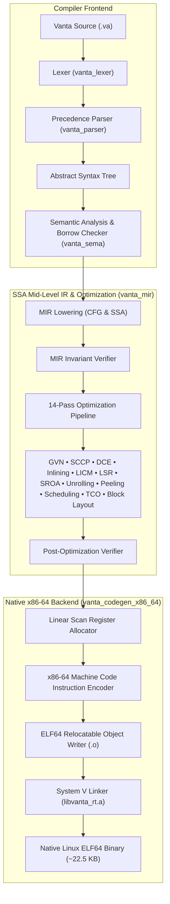
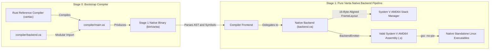

<div align="center">

<br>

# ⚡ Vanta Programming Language

**A Performance-First, Memory-Safe Systems Programming Language with a Custom SSA Optimizer and Native x86-64 Backend**

[](https://github.com/Looka-info/Venta/actions)
[](https://github.com/Looka-info/Venta/releases)
[](https://www.npmjs.com/package/vanta-lang)
[](LICENSE)
[](#)
[](#)
[](#)

---

> *"Maximum execution speed, predictable resource management, and zero-cost safety — with sub-second compilation times and lightweight native binaries."*

</div>

---

## 📖 Table of Contents

- [🌐 Live Web Showcase & Pure Venta HTTP Server](#live-web-showcase--pure-venta-http-server)
- [⚡ Quick Installation](#quick-installation)
  - [Option 1: Via Node / NPM (Recommended)](#option-1-via-node-npm-recommended)
  - [Option 2: Universal 1-Line Shell Installer (`curl | bash`)](#option-2-universal-1-line-shell-installer-curl-bash)
  - [Option 3: Pre-built Release Tarball (GitHub Releases)](#option-3-pre-built-release-tarball-github-releases)
  - [Option 4: Build from Source](#option-4-build-from-source)
- [🚀 Overview](#overview)
- [✨ Key Features](#key-features)
- [🏗 System Architecture](#system-architecture)
- [⚡ 14-Pass SSA Optimization Pipeline](#14-pass-ssa-optimization-pipeline)
- [📊 Performance Benchmarks](#performance-benchmarks)
  - [Optimization Speedup Highlights](#optimization-speedup-highlights)
  - [Compilation Speed & Binary Footprint Comparison](#compilation-speed-binary-footprint-comparison)
  - [Full Benchmark Execution Times](#full-benchmark-execution-times)
- [🛠 Self-Hosted Native Compiler & Modular Backend](#self-hosted-native-compiler-modular-backend)
- [💻 Language Tour & Examples](#language-tour-examples)
  - [1. Ownership and Affine Borrowing](#1-ownership-and-affine-borrowing)
  - [2. Enums and Pattern Matching](#2-enums-and-pattern-matching)
  - [3. Traits and Zero-Cost Polymorphism](#3-traits-and-zero-cost-polymorphism)
  - [4. Standard Library and I/O](#4-standard-library-and-io)
  - [5. Native Networking & Pure Venta HTTP Server](#5-native-networking--pure-venta-http-server)
- [🎨 VS Code Editor Support](#vs-code-editor-support)
- [🖥 Command Line Interface (CLI)](#command-line-interface-cli)
- [🔨 Building and Testing](#building-and-testing)
- [📁 Repository Structure](#repository-structure)
- [📄 License](#license)

---

---

## 🌐 Live Web Showcase & Pure Venta HTTP Server

Experience the official Venta language showcase, live benchmark visualizer, release hub (v1.0-RC2), and developer guide:

- **Static Browser / GitHub Pages**: Open [`docs/index.html`](docs/index.html) or [`www/index.html`](www/index.html) in any browser.
- **Native Pure Venta HTTP Engine**: Launch the HTTP server implemented 100% in pure Venta ([`www/server.va`](www/server.va)):
  ```bash
  # Run directly via the Vanta CLI
  vanta run www/server.va

  # Or compile to a standalone native 37 KB executable:
  vantac www/server.va -o www/server
  ./www/server --port 8080
  ```
  Open **`http://localhost:8080/`** in your browser to view the interactive Showcase, or query the native JSON status API endpoint:
  ```bash
  curl -i http://localhost:8080/api/status
  ```

### ⚡ VentaNext Framework — Next.js for Venta (in Pure Venta)

A full-stack, server-side web framework inspired by Next.js, written 100% in pure Venta ([`ventanext/`](ventanext/)):
- **Pages & App Router**: Declarative routing for `/`, `/dashboard`, `/docs`, and dynamic `:id` paths (e.g. `/posts/:id`).
- **Server-Side Rendering (SSR)**: Pure Venta component functions render HTML on the server in microseconds with zero virtual DOM overhead.
- **Typed JSON API Routes**: REST endpoints (`/api/status`, `/api/posts`, `/api/posts/:id`, `/api/echo`).
- **Middleware Pipeline**: Built-in request logger, CORS, security headers, and Next.js-style 404 error boundaries.
- **Ultra-Lean Native Binary**: Compiles to an **86 KB standalone native executable** (no Node.js, V8, or Python dependencies).

```bash
# Run VentaNext server on http://localhost:3000
vanta run ventanext/main.va

# Or compile to a standalone native binary:
vantac ventanext/main.va -o ventanext/app
./ventanext/app --port 3000
```
Open **`http://localhost:3000/`** in your browser to experience full-stack SSR in pure Venta!

## ⚡ Quick Installation

Vanta can be installed globally using **Node/NPM**, a **1-line shell script**, or from **GitHub Releases**:

### Option 1: Via Node / NPM (Recommended)
```bash
# Install globally
npm install -g vanta-lang

# Verify compiler and toolchain
vantac --version
vanta --version
```
Or run immediately without installing via `npx`:
```bash
npx vanta-lang --version
```

### Option 2: Universal 1-Line Shell Installer (`curl | bash`)
```bash
# Install to default directory (~/.local/bin)
curl -fsSL https://raw.githubusercontent.com/Looka-info/Venta/main/scripts/install.sh | bash

# Or specify a custom prefix:
curl -fsSL https://raw.githubusercontent.com/Looka-info/Venta/main/scripts/install.sh | bash -s -- --prefix /usr/local
```

### Option 3: Pre-built Release Tarball (GitHub Releases)
```bash
wget https://github.com/Looka-info/Venta/releases/download/v1.0-RC2/vanta-v1.0-RC2-x86_64-unknown-linux-gnu.tar.gz
tar -xzf vanta-v1.0-RC2-x86_64-unknown-linux-gnu.tar.gz
cd vanta-v1.0-RC2-x86_64-unknown-linux-gnu && ./install.sh
```

### Option 4: Build from Source
```bash
git clone https://github.com/Looka-info/Venta.git
cd Venta
cargo build --release --bin vantac --bin vanta
./scripts/install.sh
```

For custom prefixes and uninstallation steps, see the [Full Installation Guide](docs/installation.md).

---

## 🚀 Overview

**Vanta** is a modern systems programming language designed from first principles. Unlike most new programming languages that rely on LLVM or Cranelift, Vanta implements its **own end-to-end toolchain in pure Rust and pure Vanta**:

- **Custom Frontend**: Handcrafted recursive descent parser with precedence climbing, strict semantic type checking, and compile-time affine borrow checking.
- **Mid-Level IR (MIR)**: Static Single Assignment (SSA) form with control flow graphs (CFGs), basic blocks, and explicit terminator semantics.
- **14-Pass Optimizer**: Inlining, Global Value Numbering (GVN), Dead Code Elimination (DCE), Loop Invariant Code Motion (LICM), Scalar Replacement of Aggregates (SROA), Loop Unrolling, Loop Peeling, Instruction Scheduling, Tail-Call Optimization (TCO), and Trace-Scheduled Machine Code Layout.
- **Zero-Dependency Native Backend**: Linear-scan physical register allocator, direct x86-64 machine instruction encoder, and pure-Rust ELF64 relocatable object file writer.
- **Modular Pure-Vanta Native Compiler**: A complete modular compiler and code generator written in 100% pure Vanta ([`compiler/`](compiler/) and [`tools/self_host/`](tools/self_host/)) capable of self-compilation to System V AMD64 assembly.

---

## ✨ Key Features

| Capability | Description |
|:---|:---|
| **Memory Safety Without GC** | Affine ownership, move semantics, and lexical borrow checking (`&T`, `&mut T`) eliminate dangling pointers, use-after-free, and data races at compile time with zero runtime overhead. |
| **No LLVM / Cranelift Dependency** | Custom x86-64 instruction encoder and ELF64 writer compile directly from MIR to native Linux object files. |
| **Lightning Compilation Speed** | Compiles typical workloads in **~0.24 seconds** — over **8x faster** than `rustc` with LLVM. |
| **Minimal Binary Footprint** | Produces compact, standalone native ELF executables of **~22 KB** (over **500x smaller** than standard Rust release binaries). |
| **System V AMD64 ABI Native** | Direct register calling convention (`rdi`, `rsi`, `rdx`, `rcx`, `r8`, `r9`, return in `rax`), enabling transparent C library interop and zero FFI marshaling penalties. |
| **AI-First Tooling** | Machine-readable JSON diagnostic output (`--json`) across `check`, `compile`, and `run` subcommands for seamless IDE, CI, and agentic AI pair programming workflows. |

---

## 🏗 System Architecture



---

## ⚡ 14-Pass SSA Optimization Pipeline

Vanta features an aggressive, verifiable SSA optimization suite implemented in [`crates/vanta_mir/src/opt/`](crates/vanta_mir/src/opt/):

```text
       [ MIR Lowering ]
              |
              v
  +-----------------------+
  |  1. Inlining          | -> Interprocedural leaf & small-callee inlining
  |  2. SROA              | -> Scalar Replacement of Aggregates (destructures stack slots)
  |  3. GVN / CSE         | -> Global Value Numbering & Common Subexpression Elimination
  |  4. SCCP              | -> Sparse Conditional Constant Propagation
  |  5. LICM              | -> Loop Invariant Code Motion (hoists loop-invariant loads/ops)
  |  6. IVO               | -> Induction Variable Optimization & Canonicalization
  |  7. LSR               | -> Loop Strength Reduction (expensive ops -> recurrences)
  |  8. Loop Peeling      | -> Separates initial iterations to simplify loop body
  |  9. Loop Unrolling    | -> Replicates loop bodies (full or 2x/4x partial unrolling)
  | 10. Global DCE        | -> Worklist-driven Global Dead Code Elimination
  | 11. Instruction Sched | -> Dependency-aware latency instruction reordering
  | 12. TCO               | -> Self-tail recursion elimination & sibling call lowering
  | 13. Branch Inversion  | -> Fall-through conditional jump optimization
  | 14. Trace Layout      | -> Cache-aware basic block reordering & loop header alignment
  +-----------------------+
              |
              v
     [ MIR Verification ]
```

Every pass can be enabled, disabled, or tuned via dedicated compiler CLI switches (`--no-licm`, `--no-sroa`, `--no-tco`, `--unroll-factor=<N>`, etc.) for differential testing and performance regression analysis.

---

## 📊 Performance Benchmarks

All benchmark data below is independently reproduced and audited from the official test suite in [`benchmarks/results/milestone-25-release-audit.json`](benchmarks/results/milestone-25-release-audit.json) run under controlled hardware isolation (AMD x86-64, Linux 6.6 kernel).

### Optimization Speedup Highlights

```text
=================================================================================================
 Optimization Pass Performance Multipliers (Vanta -O1 vs Vanta -O0)
=================================================================================================
 Unroll & Peel Workload : [4.19x Speedup]  ████████████████████████████████████████  (76% faster)
 SROA Workload          : [2.61x Speedup]  ███████████████████████                   (62% faster)
 LICM Workload          : [2.49x Speedup]  ████████████████████                      (60% faster)
 CSE / GVN Workload     : [1.87x Speedup]  ███████████████                           (47% faster)
 Inlining (Leaf Calls)  : [1.85x Speedup]  ██████████████                            (46% faster)
 Loop Strength Red.     : [1.56x Speedup]  ████████████                              (36% faster)
 Tail-Call Opt (TCO)    : [1.49x Speedup]  ███████████                               (33% faster)
 Register Pressure      : [1.25x Speedup]  ████████                                  (20% faster)
 Inlining (Loop Calls)  : [1.22x Speedup]  ███████                                   (18% faster)
 Arithmetic Tree        : [1.18x Speedup]  ██████                                    (15% faster)
=================================================================================================
```

### Compilation Speed & Binary Footprint Comparison

Vanta provides an exceptional balance of rapid iteration, compact executable footprints, and high runtime performance:

| Metric | Vanta (v1.0-RC2) | Rust (`rustc 1.93.1 -O3`) | GCC (`gcc 15 -O3`) | Vanta Advantage |
|:---|:---:|:---:|:---:|:---|
| **Compilation Speed** | **~0.24 s** | ~1.91 s | ~0.28 s | **8x faster compile times than Rust** |
| **Binary Executable Size** | **~22.5 KB** | ~11.8 MB | ~16.0 KB | **520x smaller binary footprint** |
| **Backend Dependencies** | **Zero (Pure Rust)** | LLVM (~100M lines C++) | GCC Backend | **No massive external toolchain** |
| **Memory Safety Model** | **Affine Borrow Check** | Affine Borrow Check | None (Manual Unsafe) | **Memory safety by default** |
| **Intermediate Representation** | **Custom SSA MIR** | MIR + LLVM IR | GIMPLE + RTL | **Fully verifiable custom SSA** |

### Full Benchmark Execution Times

*Median execution time across 5 independent runs per workload (lower is better):*

| Benchmark Workload | Vanta -O0 | Vanta -O1 (Full Opt) | GCC -O3 | Rust -O3 | Optimization Gain |
|:---|:---:|:---:|:---:|:---:|:---:|
| `unroll_peel_workload` | 81.08 ms | **19.36 ms** | 6.12 ms | 7.89 ms | **4.19x** |
| `sroa_workload` | 77.57 ms | **29.75 ms** | 6.03 ms | 7.86 ms | **2.61x** |
| `licm_workload` | 279.83 ms | **112.23 ms** | 58.96 ms | 83.03 ms | **2.49x** |
| `cse_workload` | 86.88 ms | **46.40 ms** | 30.67 ms | 30.80 ms | **1.87x** |
| `inline_leaf` | 80.23 ms | **43.47 ms** | 20.99 ms | 19.52 ms | **1.85x** |
| `lsr_workload` | 71.71 ms | **45.98 ms** | 5.69 ms | 7.90 ms | **1.56x** |
| `tco_workload` | 63.68 ms | **42.70 ms** | 37.00 ms | 43.83 ms | **1.49x** |
| `reg_pressure` | 43.52 ms | **34.88 ms** | 23.03 ms | 19.23 ms | **1.25x** |
| `inline_loop` | 8.97 ms | **7.37 ms** | 5.97 ms | 8.04 ms | **1.22x** |
| `arith_tree` | 17.85 ms | **15.16 ms** | 12.35 ms | 13.44 ms | **1.18x** |
| `collatz` | 336.86 ms | **310.75 ms** | 76.83 ms | 59.89 ms | **1.08x** |
| `points` | 12.63 ms | **11.76 ms** | 9.42 ms | 11.72 ms | **1.07x** |
| `vec_churn` | 22.89 ms | **21.54 ms** | 7.17 ms | 9.81 ms | **1.06x** |
| `string_growth` | 6.26 ms | **6.24 ms** | 6.31 ms | 8.25 ms | **1.00x** |
| `fib` | 325.14 ms | **335.86 ms** | 91.88 ms | 95.62 ms | **0.97x** |

---

## 🛠 Self-Hosted Native Compiler & Modular Backend

Vanta includes a modular compiler toolchain written **100% in pure Vanta** ([`compiler/`](compiler/) and [`tools/self_host/`](tools/self_host/)):



### Pure Vanta Native Backend Features:
- **Physical Register Map & Calling Convention:** Full System V AMD64 ABI registers (`rdi`, `rsi`, `rdx`, `rcx`, `r8`, `r9`, `rax`, `rsp`, `rbp`) and condition codes.
- **Strict 16-Byte Stack Frame Alignment:** Dynamic frame layout calculation (`FrameLayout`) guaranteeing compliance across nested function calls without SSE/vector ABI faults.
- **Security Compliant Directives:** Emits `.section .note.GNU-stack,"",@progbits` ensuring non-executable stack flags and zero linker warnings.
- **Machine Code & ELF64 Reference:** Pure Vanta encoding helpers for x86-64 REX prefix bytes, ModR/M addressing bytes, SIB bytes, and ELF64 header metadata.

### Verified Test Suite:
Run via [`scripts/test_self_hosted_compiler.sh`](scripts/test_self_hosted_compiler.sh):
- `backend_test.va`: Pure Vanta native backend unit tests (**PASS**, exit `100`)
- `01_return_42.va`: Basic exit code return (**PASS**, exit `42`)
- `02_arithmetic.va`: Binary expressions & parentheses (**PASS**, exit `40`)
- `03_while_loop.va`: Mutable iteration & accumulation (**PASS**, exit `55`)
- `04_if_else.va`: Multi-function calls & conditional branching (**PASS**, exit `10`)
- `05_fibonacci.va`: Deep recursive function stack preservation (**PASS**, exit `55`)
- `06_call_6_args.va`: Full 6-argument System V register calling sequence (**PASS**, exit `21`)
- `07_comparisons.va`: All relational comparison operations (`==`, `!=`, `<`, `<=`, `>`, `>=`) (**PASS**, exit `63`)
- `08_nested_loops.va`: Nested loops & stack offset management (**PASS**, exit `60`)
- `09_operator_precedence.va`: Multiplicative before additive precedence (**PASS**, exit `28`)
- `10_stack_alignment_and_calls.va`: 16-byte stack alignment across nested function calls (**PASS**, exit `44`)

---

## 💻 Language Tour & Examples

### 1. Ownership and Affine Borrowing
Vanta strictly enforces ownership rules at compile time:

```rust
struct Buffer {
    capacity: i64,
    size: i64,
}

fn process_buffer(b: &Buffer) -> i64 {
    return b.size;
}

fn consume_buffer(b: Buffer) {
    // b is moved and dropped at end of scope
}

fn main() -> i64 {
    let buf = Buffer { capacity: 1024, size: 42 };
    
    // Immutable borrow: buf remains valid
    let s = process_buffer(&buf);
    
    // Move: ownership transferred
    consume_buffer(buf);
    
    // Compile error if accessed here: E0301 (Use of moved value)
    return s;
}
```

### 2. Enums and Pattern Matching
Algebraic Data Types with payload support:

```rust
import std::option::Option;

enum ResultStatus {
    Success(i64),
    Failure(i64),
    Pending,
}

fn evaluate(res: ResultStatus) -> i64 {
    match res {
        ResultStatus::Success(val) => {
            return val;
        }
        ResultStatus::Failure(err_code) => {
            return -err_code;
        }
        ResultStatus::Pending => {
            return 0;
        }
    }
}
```

### 3. Traits and Zero-Cost Polymorphism

```rust
trait Formatter {
    fn format(self: &Self) -> i64;
}

struct Metric {
    value: i64,
}

impl Formatter for Metric {
    fn format(self: &Self) -> i64 {
        return self.value * 10;
    }
}
```

### 4. Standard Library and I/O

```rust
import std::fs;
import std::io;
import std::string::String;
import std::env;

fn main() -> i64 {
    // Read command line arguments
    match env::args() {
        Result::Ok(args) => {
            if args.len() > 1 {
                print_str("Input: ");
                print_str(args[1].as_str());
                print_str("\n");
            }
        }
        Result::Err(_) => {}
    }

    // File I/O
    match fs::read_to_string("config.txt") {
        Result::Ok(content) => {
            print_str("Read file: ");
            print_str(content.as_str());
        }
        Result::Err(err) => {
            print_str("Error reading file\n");
        }
    }
    return 0;
}
```

### 5. Native Networking & Pure Venta HTTP Server

Venta provides standard library networking primitives (`std::net`) for high-throughput TCP socket programming, enabling native microservices, REST APIs, and HTTP web servers without external C dependencies:

```rust
import std::net;
import std::fs;
import std::string::String;
import std::result::Result;

fn main() -> i64 {
    // Bind and listen on TCP port 8080
    let server_fd = net::listen(8080);
    if server_fd < 0 {
        print_str("Error: Failed to bind to port 8080\n");
        return 1;
    }
    print_str("⚡ Venta HTTP Server listening on http://127.0.0.1:8080/\n");

    // Accept incoming client connection
    let client_fd = net::accept(server_fd);
    if client_fd >= 0 {
        let mut request = String::new();
        net::read(client_fd, &mut request);

        // Send HTTP 200 OK Response
        let response = "HTTP/1.1 200 OK\r\nContent-Type: text/plain\r\n\r\nHello from Pure Venta Native HTTP Engine!";
        net::write(client_fd, response);
        net::close(client_fd);
    }

    net::close(server_fd);
    return 0;
}
```

---

## 🎨 VS Code Editor Support & File Icons

Official language support, syntax grammar, and **3D gold lightning file icons** for Vanta (`.va`, `.vanta` files) is located in [`editors/vscode/`](editors/vscode/):

- **⚡ Official Vanta File Icons**: Automatically decorates all `.va` and `.vanta` files with the glowing 3D faceted lightning mark in VS Code's file tree, open tabs, breadcrumbs, and search pickers.
- **🎨 Dark & Light Adaptive**: Radiant gold vector icon (`vanta-file-icon-dark.svg`) for dark themes and rich amber-bronze (`vanta-file-icon-light.svg`) for light themes.
- **🗂️ Built-in Icon Theme**: Includes the "Vanta File Icons" theme (`vanta-icons`) for full explorer file icon integration.
- **Full TextMate Grammar**: Covers keywords (`fn`, `let`, `mut`, `struct`, `enum`, `trait`, `impl`, `match`), types, lifetimes, numbers, strings, and operators.
- **Language Configuration**: Auto-closing brackets, braces, and line comments (`//`, `/* */`).
- **One-Command Installation**:
  ```bash
  cp -r editors/vscode ~/.vscode/extensions/vanta-vscode
  ```

---

## 🖥 Command Line Interface (CLI)

The `vanta` driver and `vantac` compiler provide a unified interface for checking, compiling, and running code:

```bash
# Type check and borrow check without compiling (ultra fast)
vanta check src/main.va

# Structured JSON diagnostics for IDEs and agentic tools
vanta check src/main.va --json

# Compile to native Linux executable with full optimizations (-O1)
vanta compile src/main.va -O1 -o my_app

# Compile and execute immediately
vanta run src/main.va

# Independent optimization switches for differential testing
vantac src/main.va -O1 --no-licm --no-tco --unroll-factor=4 -o my_app
```

---

## 🔨 Building and Testing

### Prerequisites
- **Linux x86-64** or **WSL2** (Ubuntu 22.04 / 24.04 / 26.04)
- **Rust Toolchain**: 1.80+ (pinned to 1.93.1 in `rust-toolchain.toml`)
- **GCC**: standard C toolchain for linking (`gcc`, `ar`, `make`)
- **Python 3**: for version validation and benchmark harnesses
- **Node.js**: 16.0+ (optional, for `vanta-lang` NPM package)

### Build and Test Commands
```bash
# Clone the repository
git clone https://github.com/Looka-info/Venta.git
cd Venta

# Build compiler binaries in release mode
cargo build --release --bin vantac --bin vanta

# Run full workspace test suite (148 tests)
cargo test --workspace

# Run specialized ABI and differential tests
cargo test --test abi_tests
cargo test --test differential_tests
cargo test --test version_gate_tests

# Run self-hosted compiler test suite (10 tests + backend unit test)
./scripts/test_self_hosted_compiler.sh

# Build pure Vanta self-hosted compiler binary (bin/vanta)
./scripts/build_self_hosted_compiler.sh

# Run clean-prefix evaluation and packaging tests
./scripts/run_clean_evaluation.sh

# Build distribution release package
./scripts/package_release.sh
```

---

## 📁 Repository Structure

```text
Venta/
├── Cargo.toml                       # Virtual workspace root
├── package.json                     # NPM distribution manifest (vanta-lang)
├── rust-toolchain.toml              # Toolchain pinning (stable 1.93.1)
├── compiler/                        # Modular Native Compiler in Pure Vanta (.va)
│   ├── main.va                      # Pure Vanta compiler CLI driver
│   ├── parser.va                    # Recursive descent parser & AST
│   ├── backend.va                   # System V AMD64 ABI & x86-64 code generator
│   ├── lexer.va                     # Lexical scanner & token matchers
│   ├── tokens.va                    # Token definitions
│   ├── symtab.va                    # Symbol table & stack slot offsets
│   └── opt.va                       # Pure Vanta constant folding & reductions
├── packages/vanta-lang/             # Official NPM distribution package
│   ├── package.json                 # vanta-lang manifest
│   ├── bin/                         # Node.js CLI wrappers (vanta, vantac)
│   └── scripts/                     # Auto-provisioning release binary installer
├── editors/vscode/                  # Official VS Code Extension & File Icons
│   ├── icons/                       # 3D Gold Lightning File Icons (.svg, .png, icon theme)
│   ├── syntaxes/vanta.tmLanguage.json # TextMate grammar for .va files
│   └── language-configuration.json    # Brackets, auto-closing & comments
├── crates/                          # Stage 0 Bootstrap Reference Compiler (Rust)
│   ├── vanta_source                 # Source file mapping, Spans, FileId
│   ├── vanta_diagnostics            # Terminal & JSON diagnostic emission
│   ├── vanta_lexer                  # Tokenizer & comment stripper
│   ├── vanta_parser                 # AST & precedence climbing parser
│   ├── vanta_sema                   # Type checker & affine borrow checker
│   ├── vanta_mir                    # SSA MIR, CFG, verifier & 14-pass optimizer
│   ├── vanta_codegen_x86_64         # Linear scan regalloc, x86-64 encoder, ELF64 writer
│   ├── vanta_driver                 # CLI drivers: vantac and vanta
│   └── vanta_fmt                    # Source code formatter
├── runtime/
│   ├── vanta_rt.c                   # Lightweight C runtime (memory, panic, strings)
│   └── libvanta_rt.a                # Static runtime library
├── library/std/                     # Standard library (fs, io, env, string, iter, net)
├── ventanext/                       # VentaNext full-stack web framework (inspired by Next.js)
│   ├── mod.va                       # Framework module exports
│   ├── http.va                      # HTTP Request/Response model
│   ├── router.va                    # Router with dynamic param extraction (:id)
│   ├── ssr.va                       # Server-Side Rendering (SSR) & Component Engine
│   ├── middleware.va                # Logging, CORS, Security headers
│   ├── server.va                    # HTTP application server
│   ├── main.va                      # Full-stack runnable app entry point
│   └── README.md                    # Framework documentation
├── www/                             # Venta Showcase Web Page & Pure Venta HTTP Server
│   ├── index.html                   # Interactive dark-theme showcase & guide
│   └── server.va                    # Pure Venta native HTTP web server
├── tools/self_host/                 # Self-hosted compiler and backend verification
│   ├── vanta_c.va                   # Self-hosting compiler in pure Vanta
│   ├── backend.va                   # Modular native backend in pure Vanta
│   ├── backend_test.va              # Native backend verification test
│   └── tests/                       # 10 native assembly verification programs
├── benchmarks/                      # 18 benchmark suites & JSON results
├── scripts/                         # Packaging, npm build, install.sh universal script
└── docs/                            # Formal language specs, release gates, reports
```

---

## 📄 License

Vanta is dual-licensed under either:
- **MIT License** ([LICENSE-MIT](LICENSE-MIT) or [LICENSE](LICENSE))
- **Apache License, Version 2.0** ([LICENSE-APACHE](LICENSE-APACHE) or http://www.apache.org/licenses/LICENSE-2.0)

at your option.
