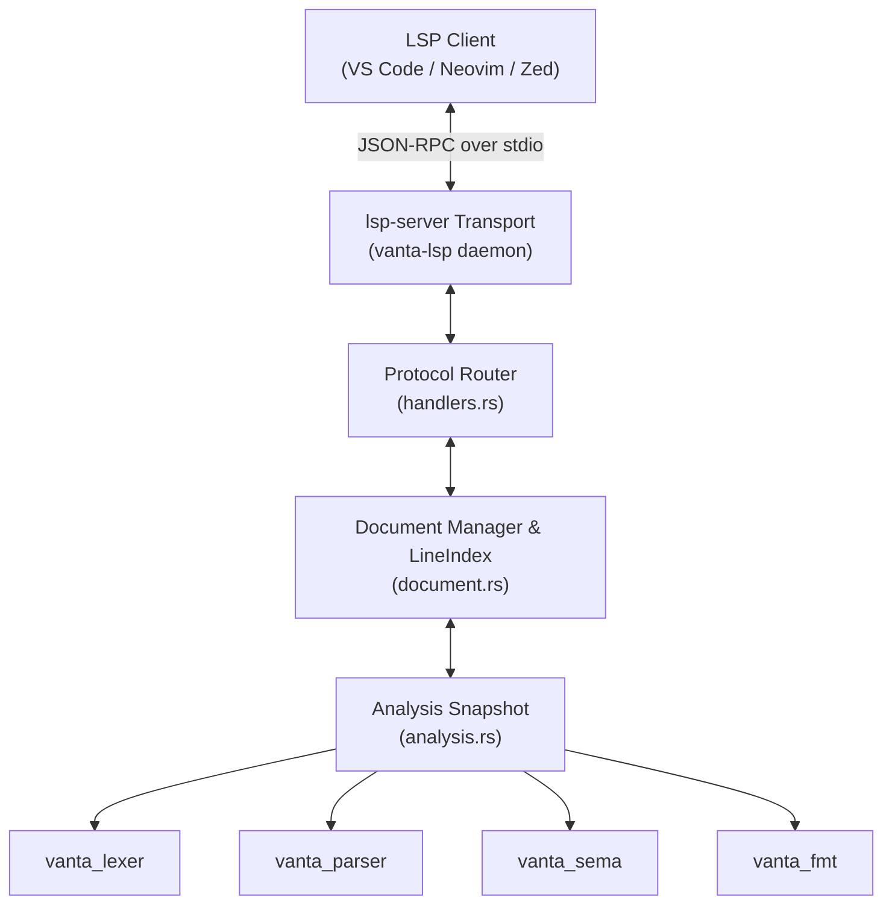

# Venta Language Server Protocol (`vanta-lsp`) Guide

## 1. Overview & Architecture

The **Venta Language Server** (`vanta-lsp`) is an official Language Server Protocol (LSP 3.17) daemon for the Venta programming language. It connects modern developer editors—including **VS Code**, **Neovim**, **Zed**, **Helix**, and **Emacs**—directly to the Venta compiler frontend and canonical code formatter.

Rather than invoking external compiler subprocesses on each keystroke, `vanta-lsp` operates directly on in-memory buffers through the existing compiler crates:



### Architectural Principles

1. **Zero Redundant Parsers**: `vanta-lsp` uses the exact same `vanta_lexer`, `vanta_parser`, and `vanta_sema` crates as `ventac`. AST nodes, type representation, symbol tables, and diagnostics are identical between the command-line compiler and the editor.
2. **Deterministic UTF-16 Translation**: LSP positions are represented as 0-indexed line and character offsets measured in UTF-16 code units. The internal `LineIndex` converts bi-directionally between UTF-8 byte offsets used by compiler spans and LSP UTF-16 code units, correctly handling multi-byte Unicode and surrogate pairs (e.g. emojis).
3. **Sub-millisecond In-Memory Analysis**: Diagnostics, hovers, completions, and symbols are derived from an in-memory `AnalysisSnapshot` created without disk writes or subprocess overhead.
4. **Resilient Error Recovery**: Syntax or semantic errors do not crash the server. Diagnostics are published live as the user types, and prior valid semantic structures are leveraged for fallback completion and hover.

---

## 2. Capabilities & Features

| Capability | LSP Method | Description |
|---|---|---|
| **Text Document Sync** | `textDocument/didOpen`<br/>`textDocument/didChange`<br/>`textDocument/didClose`<br/>`textDocument/didSave` | Supports full and incremental document synchronization (`TextDocumentSyncKind::INCREMENTAL`). Automatically clears diagnostics on document close. |
| **Live Diagnostics** | `textDocument/publishDiagnostics` | Real-time syntax and semantic errors, including type mismatches (`E0201`), undefined symbols (`E0202`), mutability violations, and parser errors with exact source spans and error codes. |
| **Hover Information** | `textDocument/hover` | Type and signature inspection formatted as Markdown code blocks for local variables (`let [mut] name: Type`), functions (`fn name(params) -> ReturnType`), structs, enums, and traits. |
| **Go to Definition** | `textDocument/definition` | Navigates directly to the declaration location of variables, parameters, functions, structs, enums, and traits. |
| **Code Completion** | `textDocument/completion` | Context-aware autocompletion for language keywords, in-scope local variables, visible functions, and types. |
| **Document Symbols** | `textDocument/documentSymbol` | Hierarchical symbol tree for editor outline navigation, breadcrumbs, and symbol search (functions, structs with fields, enums with variants, traits, and impl blocks). |
| **Code Formatting** | `textDocument/formatting` | Invokes the canonical `vanta_fmt` engine on the entire document, returning precise `TextEdit` replacements. |

---

## 3. Installation & CLI Usage

### Building from Source

Build the release binary using Cargo:

```bash
cargo build --release --bin vanta-lsp
```

The compiled binary will be placed at:
```bash
target/release/vanta-lsp
```

To make `vanta-lsp` accessible system-wide:

```bash
# Copy to local user cargo bin (recommended if ~/.cargo/bin is in PATH)
cp target/release/vanta-lsp ~/.cargo/bin/

# Or install to system bin directory
sudo cp target/release/vanta-lsp /usr/local/bin/
```

### CLI Options

The server communicates via standard input/output (stdio) by default:

```bash
$ vanta-lsp --help
Venta Language Server Protocol Daemon (vanta-lsp) v1.0.0-rc.2

USAGE:
    vanta-lsp [OPTIONS]

OPTIONS:
    -v, --version         Print version information
    -h, --help            Print help information

DESCRIPTION:
    Communicates via JSON-RPC over standard input/output (stdio) with LSP-compatible
    editors (VS Code, Neovim, Zed, Helix, Emacs) to provide live diagnostics,
    hover information, go-to-definition, code completion, document symbols,
    and canonical formatting.
```

---

## 4. Editor Configuration

### Neovim (Native LSP)

Add the following to your Neovim configuration (e.g., `~/.config/nvim/init.lua` or `after/ftplugin/venta.lua`):

```lua
-- Register Venta filetype
vim.filetype.add({
  extension = {
    va = "venta",
  },
})

-- Start vanta-lsp when a Venta file is opened
vim.api.nvim_create_autocmd("FileType", {
  pattern = "venta",
  callback = function(args)
    vim.lsp.start({
      name = "vanta-lsp",
      cmd = { "vanta-lsp" },
      root_dir = vim.fs.root(args.buf, { "Cargo.toml", "venta.toml", ".git" }),
      settings = {},
    })
  end,
})
```

If using `nvim-lspconfig`:

```lua
local lspconfig = require("lspconfig")
local configs = require("lspconfig.configs")

if not configs.vanta_lsp then
  configs.vanta_lsp = {
    default_config = {
      cmd = { "vanta-lsp" },
      filetypes = { "venta" },
      root_dir = lspconfig.util.root_pattern("Cargo.toml", "venta.toml", ".git"),
      settings = {},
    },
  }
end

lspconfig.vanta_lsp.setup({})
```

---

### Zed Editor

In Zed, configure custom language servers in your `settings.json`:

```json
{
  "languages": {
    "Venta": {
      "language_servers": ["vanta-lsp"],
      "format_on_save": "on"
    }
  },
  "lsp": {
    "vanta-lsp": {
      "binary": {
        "path": "vanta-lsp",
        "arguments": []
      }
    }
  }
}
```

Ensure file association in `settings.json`:
```json
{
  "file_types": {
    "Venta": ["*.va"]
  }
}
```

---

### Helix

Add the language server to `~/.config/helix/languages.toml`:

```toml
[[language]]
name = "venta"
scope = "source.venta"
injection-regex = "venta"
file-types = ["va"]
roots = ["Cargo.toml", "venta.toml", ".git"]
language-servers = ["vanta-lsp"]

[language-server.vanta-lsp]
command = "vanta-lsp"
```

---

### Visual Studio Code

1. Use any generic LSP extension (e.g. *Generic LSP Client* or create a minimal Venta extension with `vscode-languageclient`).
2. Point the language server executable to `vanta-lsp`.
3. Associate `.va` file extensions with the `venta` language identifier.

Example client activation snippet:

```typescript
import * as path from 'path';
import { workspace, ExtensionContext } from 'vscode';
import { LanguageClient, LanguageClientOptions, ServerOptions } from 'vscode-languageclient/node';

let client: LanguageClient;

export function activate(context: ExtensionContext) {
    const serverOptions: ServerOptions = {
        command: "vanta-lsp",
        args: []
    };

    const clientOptions: LanguageClientOptions = {
        documentSelector: [{ scheme: 'file', language: 'venta' }],
        synchronize: {
            fileEvents: workspace.createFileSystemWatcher('**/*.va')
        }
    };

    client = new LanguageClient('vanta-lsp', 'Venta Language Server', serverOptions, clientOptions);
    client.start();
}

export function deactivate(): Thenable<void> | undefined {
    return client ? client.stop() : undefined;
}
```

---

## 5. Verification & Testing

The language server is thoroughly verified through automated tests in `crates/vanta_lsp`:

1. **Unit Tests (`document.rs`)**:
   - Bi-directional UTF-8 and UTF-16 code point mapping across ASCII, 2-byte, 3-byte, and 4-byte astral characters (emojis).
   - Incremental and full document buffer synchronization.
2. **Protocol Integration Tests (`tests/lsp_tests.rs`)**:
   - `test_lsp_lifecycle_and_capabilities`: Handshake, capability negotiation (`serverInfo`, `capabilities`), shutdown, and exit.
   - `test_lsp_diagnostics_syntax_and_semantic_errors`: Verifies live error detection on syntax errors, type mismatch (`E0201`), and automatic resolution when fixed.
   - `test_lsp_hover_and_definition`: Validates hover markdown cards for local variables and function signatures, and go-to-definition jump locations.
   - `test_lsp_completion`: Validates keyword, variable, function, and type completions.
   - `test_lsp_document_symbols`: Tests hierarchical `DocumentSymbol` trees for functions, structs, and fields.
   - `test_lsp_document_formatting`: Tests whole-document formatting integration with `vanta_fmt`.
   - `test_lsp_end_to_end_stdio_subprocess`: Spawns the compiled `vanta-lsp` binary and executes a complete JSON-RPC stdio session across initialization, open, change, hover, formatting, close, shutdown, and exit.

To run the verification suite:

```bash
cargo test -p vanta_lsp
```

---

## 6. Known Limitations & Roadmap

- **Workspace-wide indexing**: The initial release analyzes open documents and visible symbols within the current compilation unit. Cross-file workspace indexing and project-wide symbol search are scheduled for subsequent milestones.
- **Incremental parsing**: Documents are re-analyzed in-memory upon change notifications. Because parsing and semantic analysis execute in < 2ms for typical files, responsiveness remains instantaneous.
