# Milestone 25 Baseline: Environment, Architecture & Integrity Audit

**Date:** October 28, 2026  
**Auditor:** Senior Compiler Engineer / x86-64 Backend & Release Auditor  
**Milestone:** 25 — v1.0 Release Readiness, Correctness Audit & Reproducible Benchmarking  

---

## 1. Environment & Toolchain Baseline

All audits, differential executions, and benchmark trials are conducted in the following verified environment:

- **Operating System:** Linux Looka `6.18.33.2-microsoft-standard-WSL2 #1 SMP PREEMPT_DYNAMIC`
- **Distribution:** Ubuntu 26.04.1 LTS (Resolute Raccoon) x86_64
- **Processor:** AMD Ryzen 5 5600 6-Core Processor (1 Socket, 6 Cores, 12 Threads, 3.50 GHz base)
- **Rust Toolchain:** `rustc 1.93.1 (01f6ddf75 2026-02-11)` / `cargo 1.93.1 (083ac5135 2025-12-15)`
- **Host C Compiler:** `gcc (Ubuntu 15.2.0-16ubuntu1) 15.2.0`
- **Runtime Environment:** `Python 3.14.4`
- **Target Triple:** `x86_64-unknown-linux-gnu` (Linux System V AMD64 ABI, ELF64 relocatable object output)

---

## 2. Test Suite Baseline

Execution of the entire workspace test suite via `cargo test --workspace` yielded:

- **Total Test Suites:** 28 suites (7 unit test targets across core crates + 21 integration test files)
- **Total Tests Passed:** 295
- **Tests Failed:** 0
- **Tests Skipped / Ignored:** 0
- **Success Rate:** 100.0%

### Breakdown by Subsystem
| Test Target | Category | Tests | Status |
|---|---|---:|:---:|
| `crates/vanta_codegen_x86_64` | Native Codegen & RegAlloc | 9 | PASS |
| `crates/vanta_diagnostics` | Diagnostic Serialization | 1 | PASS |
| `crates/vanta_fmt` | Formatter Idempotence | 14 | PASS |
| `crates/vanta_lexer` | Tokenization & Comments | 5 | PASS |
| `crates/vanta_mir` | MIR Verification & Lowering | 1 | PASS |
| `crates/vanta_parser` | AST Construction & Parsing | 6 | PASS |
| `crates/vanta_sema` | Typecheck & Borrowcheck | 10 | PASS |
| `crates/vanta_source` | Source Mapping | 1 | PASS |
| `tests/abi_tests.rs` | System V ABI & Struct Return | 8 | PASS |
| `tests/e2e_tests.rs` | End-to-End Language & Panics | 62 | PASS |
| `tests/env_tests.rs` | Standard CLI Environment | 3 | PASS |
| `tests/fmt_tests.rs` | Source Formatter CLI | 14 | PASS |
| `tests/fs_tests.rs` | File System Operations | 4 | PASS |
| `tests/global_dce_tests.rs` | Global Dead Code Elimination | 6 | PASS |
| `tests/gvn_tests.rs` | Global Value Numbering / CSE | 13 | PASS |
| `tests/inlining_tests.rs` | Conservative Function Inlining | 10 | PASS |
| `tests/io_tests.rs` | Standard I/O Primitives | 3 | PASS |
| `tests/ipa_tests.rs` | Interprocedural ConstProp | 7 | PASS |
| `tests/iter_tests.rs` | Iterators & For Loops | 7 | PASS |
| `tests/ivo_tests.rs` | Induction Variable Opt | 7 | PASS |
| `tests/layout_tests.rs` | Code Layout & Branch Inversion | 3 | PASS |
| `tests/licm_tests.rs` | Loop Invariant Code Motion | 9 | PASS |
| `tests/lifetime_tests.rs` | Lifetime Annotations & Borrows | 8 | PASS |
| `tests/loop_peel_tests.rs` | Loop Peeling | 4 | PASS |
| `tests/loop_unroll_tests.rs` | Loop Unrolling | 6 | PASS |
| `tests/lsr_tests.rs` | Loop Strength Reduction | 4 | PASS |
| `tests/mem2reg_tests.rs` | Memory-to-Register (SSA) | 6 | PASS |
| `tests/module_tests.rs` | Modules & Multi-File Imports | 9 | PASS |
| `tests/packaging_tests.rs` | Package & Distribute Workflows | 4 | PASS |
| `tests/regalloc_tests.rs` | Physical Register Allocator | 5 | PASS |
| `tests/sched_tests.rs` | Instruction Scheduling | 4 | PASS |
| `tests/sroa_tests.rs` | Scalar Replacement of Aggregates | 6 | PASS |
| `tests/std_tests.rs` | Standard Library Collections | 11 | PASS |
| `tests/string_tests.rs` | Owned Strings & UTF-8 Slices | 22 | PASS |
| `tests/tco_tests.rs` | Safe Tail-Call Optimization | 6 | PASS |
| `tests/trait_tests.rs` | Traits & Dynamic Dispatch | 7 | PASS |
| `crates/vanta_mir/tests/opt_tests.rs` | Optimizer Integration | 12 | PASS |

---

## 3. Optimization Pipeline & Pass Ordering

The verified default optimization pipeline in [`OptimizationPipeline::optimize_program_full`](file:///crates/vanta_mir/src/opt/mod.rs) executes in the following sequence under `-O1`:

```mermaid
flowchart TD
    PreCheck["MirVerifier::verify_program (Pre-conditions)"] --> TCO["Phase 0: Safe Tail-Call Optimization (Self-Tail to Loop)"]
    TCO --> PreDCE["Phase 1: Pre-Inlining Global DCE, SROA, Mem2Reg"]
    PreDCE --> IPA["Phase 2: Interprocedural Constant Propagation"]
    IPA --> Inline["Phase 3: Conservative Function Inlining"]
    Inline --> IntraLoop["Phase 4: Intraprocedural Optimization (Per Function)"]
    subgraph IntraLoopDetails ["Intraprocedural Optimization (Max 10 iterations)"]
        direction TB
        SROA2["SROA + Mem2Reg + DCE"] --> Peel["Loop Peeling + ConstProp + DCE"]
        Peel --> Unroll["Loop Unrolling + ConstProp + DCE"]
        Unroll --> FixedPoint["Iterative Loop: ConstProp -> IVO -> LSR -> LICM -> GVN/CSE -> DCE"]
        FixedPoint --> Sched["Instruction Scheduling (DAG-based)"]
    end
    IntraLoop --> IntraLoopDetails
    IntraLoopDetails --> PostDCE["Phase 5: Post-Optimization Global DCE"]
    PostDCE --> PostCheck["MirVerifier::verify_program (Post-conditions)"]
    PostCheck --> Backend["Backend Native Codegen"]
    subgraph BackendDetails ["Backend Machine-Code Emission"]
        direction TB
        RegAlloc["Linear-Scan Physical Register Allocator"] --> Layout["Trace-Scheduled Basic Block Layout"]
        Layout --> ISel["Instruction Selection & Sibling Tail-Call Lowering"]
        ISel --> Invert["Branch Inversion & Fall-Through Jump Elimination"]
        Invert --> Align["16-Byte Loop Header Code Alignment"]
        Align --> Encode["x86-64 Instruction Encoding & ELF64 Writer"]
    end
    Backend --> BackendDetails
```

### Pass Order Invariants
1. **Pre-Inlining Canonicalization:** SROA and Mem2Reg run before inlining so that small aggregate parameters are scalars, maximizing inlining opportunity.
2. **Fixed-Point Iteration:** The intraprocedural pass loop iterates up to 10 times or until no further transformation occurs ($\Delta = 0$).
3. **Instruction Scheduling Position:** `InstructionScheduler` runs strictly *after* all MIR transformations and *before* register allocation.
4. **Tail-Call Separation:** Self-tail recursion is handled at the MIR level (converting recursion into loop backedges), while sibling tail-calls are handled during native instruction selection (dismantling the stack frame prior to direct jump).

---

## 4. Flag Independence & Consistency Audit

Every optimization pass is controllable via independent CLI switches across both `vantac` and `vanta`:

| CLI Switch | Environment Variable / Setting | Affected Pass | Flag Independence Verified |
|---|---|---|:---:|
| `--no-global-dce` | `enable_global_dce = false` | Global DCE | Yes |
| `--no-tail-calls` / `--no-tco` | `enable_tail_calls = false` | Self & Sibling Tail Calls | Yes |
| `--no-block-layout` / `--no-layout`| `enable_block_layout = false`| Trace Scheduling & Branch Inversion | Yes |
| `--no-code-align` / `--no-align` | `enable_code_align = false` | 16-Byte Loop NOP Padding | Yes |
| `--no-inline` | `enable_inline = false` | Function Inliner | Yes |
| `--no-ipa-constprop` | `enable_ipa_constprop = false` | Interprocedural ConstProp | Yes |
| `--no-licm` | `enable_licm = false` | Loop Invariant Code Motion | Yes |
| `--no-indvar` | `enable_indvar = false` | Induction Variable Opt | Yes |
| `--no-strength-reduction` | `enable_strength_reduction = false` | Loop Strength Reduction | Yes |
| `--no-sroa` | `enable_sroa = false` | Scalar Replacement of Aggregates | Yes |
| `--no-loop-peel` / `--no-peel` | `enable_loop_peel = false` | Loop Peeling | Yes |
| `--no-loop-unroll` / `--no-unroll`| `enable_loop_unroll = false`| Loop Unrolling | Yes |
| `--no-instruction-schedule` / `--no-sched` | `enable_instruction_schedule = false` | Instruction Scheduling | Yes |
| `--no-gvn` | `enable_gvn = false` | GVN & CSE | Yes |
| `--no-mem2reg` | `enable_mem2reg = false` | Memory-to-Register (SSA) | Yes |
| `--no-regalloc` | `enable_reg_alloc = false` | Physical Register Allocator | Yes |

*Audit Finding:* Disabling any individual optimization does not disable or alter unrelated passes. Each boolean flag is passed independently through `CompilerOptions` to `OptimizationPipeline::optimize_program_full` and `X86_64Backend::compile_to_elf_full`.

---

## 5. Identified Baseline Limitations & Risks

1. **Subcommand Help Inconsistency:** Subcommands in `vanta` (`vanta compile --help`, `vanta run --help`, `vanta check --help`) currently reject `--help` as an unknown option because `-h`/`--help` is handled only globally at the top level.
2. **Deterministic Randomized / Differential Testing Suite:** While 28 comprehensive test files exist, a dedicated differential fuzzing harness comparing random expressions against reference compilers has not yet been formalized.
3. **DWARF Debug Information:** Vanta currently emits native ELF64 relocatable binaries without DWARF `.debug_*` sections. Debugging relies on standard frame pointers (`%rbp`) and ELF function symbol tables.
4. **WSL2 Linux Target Limitation:** The compiler targets Linux x86-64 ELF64. It is verified on WSL2 Linux and Linux hosts; native Windows PE/COFF is out of scope and not claimed.
