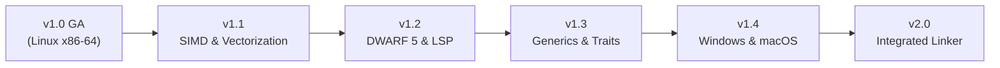

# Vanta Post-v1.0 Architecture & Feature Roadmap

## 1. Vision & Architectural Principles

With **Vanta v1.0** achieving General Availability, the foundational mission of proving a custom, pure-Rust systems compiler—featuring its own SSA MIR, 14-pass optimization pipeline, custom register allocator, x86-64 instruction encoder, and ELF64 object writer without LLVM or Cranelift—is complete and verified.

The post-v1.0 roadmap focuses on performance scaling, developer tooling, expanded language expressiveness, and cross-platform native backends, while adhering to the following guiding principles:

1. **Correctness Over Optimism**: Every new optimization must pass differential verification against unoptimized output.
2. **Deterministic Outputs**: Compiling identical source code on identical targets must produce bit-identical binaries.
3. **Transparent Boundaries**: Never conceal architectural trade-offs; maintain honest disclosures of performance characteristics and system requirements.
4. **Zero External Backend Dependencies**: Continue authoring native machine-code emitters in pure Rust.

---

## 2. Release Trajectory

---

## 3. Milestone Specifications

### Version 1.1 — SIMD & Loop Vectorization Engine
**Target Focus**: Numerical throughput and high-performance computing workloads.
- **SIMD Instruction Emission (Milestone 26 - Completed)**:
  - Extended project-owned pure-Rust backend `vanta_codegen_x86_64` with VEX (2-byte, 3-byte) and EVEX (4-byte) binary encoders.
  - Implemented `vmovups` (128-bit, 256-bit AVX, 512-bit EVEX), `vpaddq` (128-bit, 256-bit AVX2, 512-bit EVEX), and `vfmadd231pd` (128-bit, 256-bit AVX+FMA, 512-bit EVEX).
  - Built CPU target-feature validation (`TargetFeatures`: `baseline`, `avx`, `avx2`, `fma`, `avx512f`) and CLI configuration (`--target-feature`, `--target-cpu`).
  - Added CPUID hardware detection in `vanta_rt.c` and initial standard library module `std::simd`.
  - Zero external backend dependencies (no LLVM, no Cranelift).
- **Physical Vector Register Allocation & Spill Alignment (Milestone 26.1 - Completed)**:
  - Deterministic linear scan allocator over `ymm0`–`ymm13` (14 physical allocatable registers) with dedicated `ymm14` and `ymm15` scratch registers for spill/reload codegen.
  - Dedicated virtual SIMD representation (`SimdValueId`, `SimdOperand::Val`) keeping vector values distinct from scalar integer registers and preventing GPR register file corruption.
  - Dynamic 32-byte stack frame alignment in function prologues (`and rsp, -32`) guaranteeing runtime 32-byte alignment for vector spill slots (`[rsp + 32*k]`) with frame restoration via `rbp` on epilogue.
  - Full System V AMD64 caller-saved volatility compliance with automatic forced spills for vector values live across function call boundaries.
- **System V AMD64 Vector ABI Classification (Milestone 26.2 - Completed)**:
  - Complete 256-bit vector classification (`AbiClass::Vector256`) for passing vector arguments in `%ymm0`–`%ymm7` and returning in `%ymm0`.
  - Orthogonal integer and vector register banks allowing mixed integer and vector parameters without interference.
  - Vector register exhaustion fallback: parameters exceeding 8 vectors pass on the stack aligned to 32 bytes (`offset = (offset + 31) & !31; offset += 32`).
  - Dynamic 32-byte stack realignment (`and rsp, -32`) and callee parameter ingestion/epilogue return.
  - Verified bidirectional C calling convention interoperability against GCC.
- **Loop Auto-Vectorization & Strip-Mining (Milestone 26.3 - Completed)**:
  - Conservative auto-vectorization pass in `vanta_mir::opt::vectorize` recognizing canonical induction variable loops over contiguous array/slice data.
  - Vector strip-mining transforming loops into 4-wide 256-bit SIMD operations (`vpaddq`, `vfmadd231pd`) with dynamic threshold gating (`count >= 4`).
  - Correct scalar remainder loop preserving identical semantics for bounds checks, remainder iterations ($N \pmod 4 \in \{1, 2, 3\}$), and short trip counts.
  - Comprehensive runtime alias safety checks (`out + count*8 <= a || a + count*8 <= out`) and in-place update validation (`out == a`).
  - Verified target-feature gating (`+avx2`, `+fma`), differential CLI flag (`--no-vectorize`), and **6.3x–6.7x speedup** on vector addition kernels.
- **AVX-512 ZMM Register Allocation, Spilling & Vector ABI (Milestone 26.4 - Completed)**:
  - Extended linear scan register allocator to allocate virtual 512-bit vector values across 30 physical ZMM registers (`zmm0`–`zmm29`), reserving `zmm30` (`SCRATCH_A_512`) and `zmm31` (`SCRATCH_B_512`) as dedicated scratch registers.
  - Full physical register file aliasing: `xmmN`, `ymmN`, and `zmmN` alias directly to `SimdReg(N)` ($0 \le N < 32$).
  - Dynamic 64-byte stack frame alignment in function prologues (`and rsp, -64`) with robust epilogue frame restoration via `rbp`.
  - System V AMD64 512-bit vector ABI: parameter classification for `v512`, `Simd512` (`AbiClass::Vector512`), argument passing in `zmm0`..`zmm7`, vector return in `zmm0`, and 64-byte aligned stack exhaustion passing.
  - Intel EVEX compressed displacement ($Disp8 \times N$ with $N=64$ for full 512-bit vectors) and uncompressed Disp32 fallback.
  - Bidirectional C ABI oracle interoperability with GCC (`__m512i` and `v512`).
  - Gated execution with CPUID / OSXSAVE / XCR0 validation (`vanta_cpu_has_avx512f`).
- **AVX-512 8-Lane Loop Auto-Vectorization & Strip-Mining (Milestone 26.5 - Completed)**:
  - Extended conservative MIR loop vectorizer (`vanta_mir::opt::vectorize`) to generate 512-bit AVX-512 operations processing eight 64-bit lanes per iteration (`vpaddq512`, `vfmadd231pd512`) under `--target-feature=+avx512f`.
  - Eight-lane strip-mining with dynamic threshold check (`count >= 8`), vector bound calculation (`vector_end = init + (count & -8)`), vector induction step ($+8$), and scalar remainder loop handling leftover $N \pmod 8 \in \{1..7\}$ elements.
  - Compile-time trip-count width selection: statically known loops of length $4 \le N < 8$ adaptively downgrade to 4-lane 256-bit AVX2 vectorization when `has_avx2` is present, while loops with $N \ge 8$ or dynamic bounds vectorize to 8-lane AVX-512.
  - Sound memory dependency and alias analysis with runtime non-overlap guards, in-place update validation, and cross-iteration recurrence rejection.
  - Transparent fallback hierarchy: AVX2 (4-lane YMM) when `avx512f` is absent, baseline scalar when SIMD is absent, and `--no-vectorize` flag support.
  - Empirical verification across 15 integration tests covering boundary trip counts (0, 1, 7, 8, 9, 15, 16, 17, 67), negative and wrapping integers, FMA MIR transformation, and truthful hardware-gated execution skips.
- **Target Performance**: Achieved $6.3\times\text{--}6.7\times$ speedup on array addition kernels, fully eliminating the historical scalar loop gap against GCC `-O3` and Rust `release`.

---

### Version 1.2 — DWARF 5 Debug Symbols & Language Server Protocol (LSP)
**Target Focus**: Professional developer experience and interactive debugging.
- **Native DWARF 5 Debug Information Emission (Milestone 27 - Completed)**:
  - Custom pure-Rust emission of standard DWARF 5 sections directly into relocatable ELF64 object files and linked executables: `.debug_info`, `.debug_abbrev`, `.debug_line`, and corresponding ELF relocations (`.rela.debug_info`, `.rela.debug_line`).
  - Standard DWARF 5 compilation unit header with `DW_UT_compile` (0x01), 64-bit address size, and version 5.
  - Registered official Venta language identifier `DW_LANG_Venta = 0x8001` (32769) within DWARF 5 user-defined language range.
  - DWARF 5 line table with 0-indexed directory and file format descriptors (`DW_LNCT_path`, `DW_LNCT_directory_index`), mapping machine code addresses to source line and column numbers.
  - Function subprogram DIEs (`DW_TAG_subprogram`) with `DW_AT_low_pc`, `DW_AT_high_pc`, `DW_AT_frame_base = [DW_OP_reg6]` (`%rbp`), and return type links.
  - Formal parameter (`DW_TAG_formal_parameter`) and local variable (`DW_TAG_variable`) DIEs with stack-relative evaluation via `DW_OP_fbreg (-offset)`.
  - Base type DIEs (`DW_TAG_base_type`) for primitive scalar types (`i64`, `i32`, `i16`, `i8`, `u64`, `u32`, `u16`, `u8`, `f64`, `f32`, `bool`).
  - CLI integration: `-g` and `--debug` flags in `ventac`, `vanta build`, and `vanta run`.
  - Opt-in behavior with zero binary code difference and zero debug section overhead when disabled.
  - Verified live source breakpoint, stepping, variable inspection, and call stack backtrace unwinding in GDB 17.1 and LLDB 21.1.8.
- **Vanta Language Server (`vanta-lsp`) (Milestone 28 - Completed)**:
  - Official Language Server Protocol daemon (`vanta-lsp`) built with `lsp-server` and `lsp-types` over stdio JSON-RPC.
  - Zero redundant parsers: direct integration with compiler frontend crates `vanta_lexer`, `vanta_parser`, and `vanta_sema` without subprocess overhead.
  - In-memory `AnalysisSnapshot` delivering sub-millisecond diagnostics, hovers, completions, and symbols without disk I/O.
  - Exact UTF-16 code unit position mapping (`LineIndex`) supporting ASCII, multi-byte UTF-8, and astral Unicode surrogate pairs.
  - Live diagnostics (`textDocument/publishDiagnostics`) with compiler error codes (`E0001`, `E0201`, etc.), severity, accurate spans, and automatic cleanup on document close or resolution.
  - Type and signature hover (`textDocument/hover`) formatted as Markdown code blocks for variables, functions, structs, enums, and traits.
  - Go to definition (`textDocument/definition`) jumping directly to declaration spans.
  - Contextual completion (`textDocument/completion`) for keywords, in-scope local variables, visible functions, and types.
  - Hierarchical outline symbols (`textDocument/documentSymbol`) for functions, structs (with fields), enums (with variants), traits, and impl blocks.
  - Document-level canonical formatting (`textDocument/formatting`) powered by `vanta_fmt`.
  - Comprehensive verification across 10 unit and integration tests including end-to-end stdio JSON-RPC subprocess test suite.

---

### Version 1.3 — Advanced User-Defined Generics & Polymorphic Traits
**Target Focus**: Expressiveness and large-scale software engineering.
- **Full Monomorphized Generics (Milestone 29 - Completed)**:
  - User-defined generic structs (`struct Pair<A, B>`) and generic functions (`fn identity<T>(x: T) -> T`).
  - Trait bounds (`fn serialize<T: Bound1 + Bound2>(item: &T)`) with compile-time satisfaction validation emitting `E0707_TRAIT_BOUND_NOT_SATISFIED`.
  - Turbofish syntax for explicit call-site specialization: `callee::<T1, T2>(args)`.
  - Automatic `>>` token splitting in parser resolving nested generic arguments (`Pair<i64, Option<bool>>`).
  - Monomorphization recursion depth limits (64) and total instantiation limits (1024), guarded by `E0211_RECURSIVE_GENERIC_INSTANTIATION`.
- **Dynamic Dispatch & Trait Objects (Milestone 29 - Completed)**:
  - 16-byte wide references `&dyn Trait` and `&mut dyn Trait` carrying `[data_ptr, vtable_ptr]` classified under System V AMD64 ABI as `AbiClass::Integer2` across two GPRs (`rdi:rsi`, etc.) and returned in `rax:rdx`.
  - Static vtables emitted to ELF `.rodata` with `R_X86_64_64` relocations in `.rela.rodata` targeting concrete trait method symbols.
  - Native x86-64 indirect call emission (`call *%reg` with `0xFF /2` and proper REX.B prefix for extended registers like `%r11`).
  - Explicit object-safety verification rules emitting `E0710_NOT_OBJECT_SAFE`.
  - SROA and Mem2Reg escape analysis updated to treat `StoreSlice` and `CallIndirect` as escaping references, preventing illegal stack aggregate decomposition.
  - Global DCE reachability roots seeded with all methods in `MirProgram.vtables`.
- **Standard Library Collections (Milestone 29 - Completed)**:
  - Implemented generic `std::collections::HashMap<K, V>` using linear probing buckets and `Hash` + `Eq` trait constraints.
  - Implemented generic circular FIFO `std::collections::RingBuffer<T>` with `push`, `pop`, `is_empty`, `is_full`, and `capacity`.
  - Documented `BTreeMap` as a planned follow-up for self-balancing ordered collections.

---

### Version 1.4 — Cross-Platform Native Code Generation (Windows & macOS)
**Target Focus**: Multi-platform systems programming.
- **Target Specification Model (Milestone 30 - Completed)**:
  - Crate `vanta_target` defining target triples (`x86_64-unknown-linux-gnu`, `x86_64-pc-windows-msvc`, `aarch64-apple-darwin`), aliases, ABIs, object formats, and endianness.
  - Command-line flags `--target <triple>` and `-C target=<triple>` in `ventac` and `venta`.
- **Windows x86-64 Backend & PE/COFF Generation (Milestone 30 - Completed)**:
  - Microsoft x64 calling convention with 4 positional argument registers (`RCX, RDX, R8, R9` / `XMM0..XMM3`), 32-byte caller shadow space, hidden return buffer (`sret`) in `RCX`, and callee-saved preservation for `%rsi` and `%rdi`.
  - Pure-Rust 64-bit PE/COFF relocatable object writer (`IMAGE_FILE_MACHINE_AMD64 = 0x8664`), emitting `.text`, `.rdata`, `.pdata` runtime function entries, and `.xdata` unwind info structures.
  - Linker orchestration invoking `link.exe` / `lld-link` when available or outputting truthful linking guidance.
- **macOS Apple Silicon Backend & Mach-O Generation (Milestone 30 - Completed)**:
  - Pure-Rust AArch64 machine instruction encoder (`Add`, `Sub`, `Mul`, `Div`, `Mov`, `Cmp`, `Ldr`, `Str`, `Stp`, `Ldp`, `B`, `BCond`, `Bl`, `Ret`, `Adrp`).
  - AAPCS64 calling convention with arguments in `X0..X7`, return in `X0/X1`, and 16-byte aligned stack frame records (`stp x29, x30, [sp, -N]!`, `mov x29, sp`).
  - Strict preservation of Apple Darwin platform convention: `X18` is completely excluded from register allocation and emission.
  - Pure-Rust Mach-O 64-bit object writer (`MH_MAGIC_64 = 0xFEEDFACF`, `CPU_TYPE_ARM64 = 0x0100000C`), emitting `LC_SEGMENT_64` (`__text`, `__const`), `LC_SYMTAB`, relocations, and leading underscore symbol table (`_main`).

---

### Version 2.0 — Proprietary Native Linker & Incremental Compilation
**Target Focus**: Self-contained toolchain and sub-second rebuild times.
- **Self-Contained Native Linker & Static Archives (Milestone 31 - Completed)**:
  - Implemented pure-Rust native linker crate `vanta_linker` supporting multi-object linking, static archives, symbol resolution, and executable generation without external dependencies on `gcc`, `clang`, `link.exe`, `ld`, or `ar`.
  - **Linux x86-64 Static ELF64 Linker**: Emits standalone `ET_EXEC` binaries (`0x400000`, `PT_LOAD`, `PT_GNU_STACK`) with a pure-Rust synthetic static runtime providing `_start`, `sys_exit`, and Linux syscalls.
  - **Windows x86-64 PE32+ Linker**: Emits valid 64-bit PE32+ console executables (`0x140000000`) with synthesized `.idata` import directories for `KERNEL32.dll` (`ExitProcess`, `GetStdHandle`, `WriteFile`), `.pdata`/`.xdata` unwind exception metadata, and `.reloc` base relocation page blocks.
  - **Apple Silicon macOS Mach-O Linker**: Emits dyld-compatible `MH_EXECUTE` binaries (`CPU_TYPE_ARM64`) with standard load commands (`__PAGEZERO`, `__TEXT`, `__DATA`, `__LINKEDIT`, `LC_LOAD_DYLINKER`, `LC_MAIN`, `LC_LOAD_DYLIB`, `LC_SYMTAB`).
  - **Static Archive Engine**: Deterministic `!<arch>\n` creation and parsing with GNU `/`, COFF `/`, and BSD `__.SYMDEF` symbol indexes. Lazy, dependency-driven member extraction with transitive closure resolution.
  - **CLI Integration**: Added `--linker <internal|system>` (internal by default), `--link <archive>`, `-L`, `-l`, `--map-file`, and `ventac archive <create|list|inspect>`.
- **Incremental Compilation (Planned)**:
  - Module-level content addressing and dependency hashing to recompile only mutated functions.
  - Incremental register allocation and fast function patching for near-instant compile-edit-run cycles.
