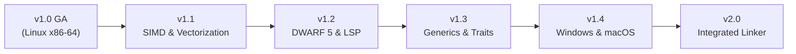

# Vanta Post-v1.0 Architecture & Feature Roadmap

## 1. Vision & Architectural Principles

With **Vanta v1.0** achieving General Availability, the foundational mission of proving a custom, pure-Rust systems compiler—featuring its own SSA MIR, 14-pass optimization pipeline, custom register allocator, x86-64 instruction encoder, and ELF64 object writer without LLVM or Cranelift—is complete and verified.

The post-v1.0 roadmap focuses on performance scaling, developer tooling, expanded language expressiveness, and cross-platform native backends, while adhering to the following guiding principles:

1. **Correctness Over Optimism**: Every new optimization must pass differential verification against unoptimized output.
2. **Deterministic Outputs**: Compiling identical source code on identical targets must produce bit-identical binaries.
3. **Transparent Boundaries**: Never conceal architectural trade-offs; maintain honest disclosures of performance characteristics and system requirements.
4. **Zero External Backend Dependencies**: Continue authoring native machine-code emitters in pure Rust.

---

## 2. Release Trajectory

---

## 3. Milestone Specifications

### Version 1.1 — SIMD & Loop Vectorization Engine
**Target Focus**: Numerical throughput and high-performance computing workloads.
- **AVX2 & SSE4.2 Instruction Emission**:
  - Extend `vanta_codegen_x86_64` with support for VEX-encoded 256-bit SIMD instructions (`vmovups`, `vpaddq`, `vpmuldq`, `vfmadd231pd`).
  - Introduce vector registers `ymm0`–`ymm15` into the physical register allocator.
- **Loop Auto-Vectorization Pass**:
  - Detect parallel loop iterations operating on contiguous slices and vectors.
  - Apply vector strip-mining to process 4 64-bit integer or double-precision floating-point operations per cycle.
- **Target Performance**: Eliminate the $5\times\text{--}8\times$ performance gap on kernels like `lsr_workload`, reaching parity with GCC `-O3` and Rust `release`.

---

### Version 1.2 — DWARF 5 Debug Symbols & Language Server Protocol (LSP)
**Target Focus**: Professional developer experience and interactive debugging.
- **DWARF 5 Section Emission**:
  - Generate `.debug_info`, `.debug_line`, `.debug_abbrev`, and `.debug_frame` directly into ELF64 object files.
  - Map source coordinates to machine instruction offsets for seamless source stepping in GDB and LLDB.
- **Vanta Language Server (`vanta-lsp`)**:
  - Provide an official LSP daemon supporting VS Code, Neovim, and Zed.
  - Features: real-time syntax checking, live borrow checker error markers, hover type inspection, go-to-definition, and canonical formatting (`vanta fmt`).

---

### Version 1.3 — Advanced User-Defined Generics & Polymorphic Traits
**Target Focus**: Expressiveness and large-scale software engineering.
- **Full Monomorphized Generics**:
  - User-defined generic structs (`struct Pair<T1, T2>`), enums (`enum Either<L, R>`), and functions (`fn swap<T>(a: &mut T, b: &mut T)`).
  - Trait bounds (`fn serialize<T: Serializable>(item: &T) -> String`).
- **Dynamic Dispatch (Trait Objects)**:
  - Vtable generation for dynamic trait pointers (`&dyn Printable`), enabling runtime polymorphism where static monomorphization is impractical.
- **Standard Library Collections**:
  - Implement `std::collections::HashMap`, `BTreeMap`, and `RingBuffer` with custom linear-probing allocators.

---

### Version 1.4 — Cross-Platform Native Code Generation (Windows & macOS)
**Target Focus**: Multi-platform systems programming.
- **Windows x86-64 Backend**:
  - Implement Microsoft x64 calling convention (`rcx`, `rdx`, `r8`, `r9`, 32-byte shadow space).
  - Direct PE/COFF object file writer (`.obj`) and integration with `link.exe` / `lld-link`.
- **macOS Apple Silicon Backend**:
  - Implement ARM64 (AArch64) instruction encoder in pure Rust.
  - Implement Mach-O 64-bit relocatable object emitter.
  - AAPCS64 calling convention and macOS ABI compliance.

---

### Version 2.0 — Proprietary Native Linker & Incremental Compilation
**Target Focus**: Self-contained toolchain and sub-second rebuild times.
- **Direct Native Executable Emission**:
  - Embed a custom static ELF64 and PE32+ linker directly into `vantac`, eliminating dependencies on external `gcc` or `clang` linkers.
- **Incremental Compilation**:
  - Module-level content addressing and dependency hashing to recompile only mutated functions.
  - Incremental register allocation and fast function patching for near-instant compile-edit-run cycles.
