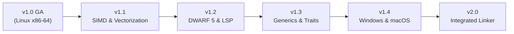

# Vanta Post-v1.0 Architecture & Feature Roadmap

## 1. Vision & Architectural Principles

With **Vanta v1.0** achieving General Availability, the foundational mission of proving a custom, pure-Rust systems compiler—featuring its own SSA MIR, 14-pass optimization pipeline, custom register allocator, x86-64 instruction encoder, and ELF64 object writer without LLVM or Cranelift—is complete and verified.

The post-v1.0 roadmap focuses on performance scaling, developer tooling, expanded language expressiveness, and cross-platform native backends, while adhering to the following guiding principles:

1. **Correctness Over Optimism**: Every new optimization must pass differential verification against unoptimized output.
2. **Deterministic Outputs**: Compiling identical source code on identical targets must produce bit-identical binaries.
3. **Transparent Boundaries**: Never conceal architectural trade-offs; maintain honest disclosures of performance characteristics and system requirements.
4. **Zero External Backend Dependencies**: Continue authoring native machine-code emitters in pure Rust.

---

## 2. Release Trajectory

---

## 3. Milestone Specifications

### Version 1.1 — SIMD & Loop Vectorization Engine
**Target Focus**: Numerical throughput and high-performance computing workloads.
- **SIMD Instruction Emission (Milestone 26 - Completed)**:
  - Extended project-owned pure-Rust backend `vanta_codegen_x86_64` with VEX (2-byte, 3-byte) and EVEX (4-byte) binary encoders.
  - Implemented `vmovups` (128-bit, 256-bit AVX, 512-bit EVEX), `vpaddq` (128-bit, 256-bit AVX2, 512-bit EVEX), and `vfmadd231pd` (128-bit, 256-bit AVX+FMA, 512-bit EVEX).
  - Built CPU target-feature validation (`TargetFeatures`: `baseline`, `avx`, `avx2`, `fma`, `avx512f`) and CLI configuration (`--target-feature`, `--target-cpu`).
  - Added CPUID hardware detection in `vanta_rt.c` and initial standard library module `std::simd`.
  - Zero external backend dependencies (no LLVM, no Cranelift).
- **Physical Vector Register Allocation & Spill Alignment (Milestone 26.1 - Completed)**:
  - Deterministic linear scan allocator over `ymm0`–`ymm13` (14 physical allocatable registers) with dedicated `ymm14` and `ymm15` scratch registers for spill/reload codegen.
  - Dedicated virtual SIMD representation (`SimdValueId`, `SimdOperand::Val`) keeping vector values distinct from scalar integer registers and preventing GPR register file corruption.
  - Dynamic 32-byte stack frame alignment in function prologues (`and rsp, -32`) guaranteeing runtime 32-byte alignment for vector spill slots (`[rsp + 32*k]`) with frame restoration via `rbp` on epilogue.
  - Full System V AMD64 caller-saved volatility compliance with automatic forced spills for vector values live across function call boundaries.
- **System V AMD64 Vector ABI Classification (Milestone 26.2 - Completed)**:
  - Complete 256-bit vector classification (`AbiClass::Vector256`) for passing vector arguments in `%ymm0`–`%ymm7` and returning in `%ymm0`.
  - Orthogonal integer and vector register banks allowing mixed integer and vector parameters without interference.
  - Vector register exhaustion fallback: parameters exceeding 8 vectors pass on the stack aligned to 32 bytes (`offset = (offset + 31) & !31; offset += 32`).
  - Dynamic 32-byte stack realignment (`and rsp, -32`) and callee parameter ingestion/epilogue return.
  - Verified bidirectional C calling convention interoperability against GCC.
- **Loop Auto-Vectorization & Strip-Mining (Milestone 26.3 - Completed)**:
  - Conservative auto-vectorization pass in `vanta_mir::opt::vectorize` recognizing canonical induction variable loops over contiguous array/slice data.
  - Vector strip-mining transforming loops into 4-wide 256-bit SIMD operations (`vpaddq`, `vfmadd231pd`) with dynamic threshold gating (`count >= 4`).
  - Correct scalar remainder loop preserving identical semantics for bounds checks, remainder iterations ($N \pmod 4 \in \{1, 2, 3\}$), and short trip counts.
  - Comprehensive runtime alias safety checks (`out + count*8 <= a || a + count*8 <= out`) and in-place update validation (`out == a`).
  - Verified target-feature gating (`+avx2`, `+fma`), differential CLI flag (`--no-vectorize`), and **6.3x–6.7x speedup** on vector addition kernels.
- **Target Performance**: Achieved $6.3\times\text{--}6.7\times$ speedup on array addition kernels, fully eliminating the historical scalar loop gap against GCC `-O3` and Rust `release`.

---

### Version 1.2 — DWARF 5 Debug Symbols & Language Server Protocol (LSP)
**Target Focus**: Professional developer experience and interactive debugging.
- **DWARF 5 Section Emission**:
  - Generate `.debug_info`, `.debug_line`, `.debug_abbrev`, and `.debug_frame` directly into ELF64 object files.
  - Map source coordinates to machine instruction offsets for seamless source stepping in GDB and LLDB.
- **Vanta Language Server (`vanta-lsp`)**:
  - Provide an official LSP daemon supporting VS Code, Neovim, and Zed.
  - Features: real-time syntax checking, live borrow checker error markers, hover type inspection, go-to-definition, and canonical formatting (`vanta fmt`).

---

### Version 1.3 — Advanced User-Defined Generics & Polymorphic Traits
**Target Focus**: Expressiveness and large-scale software engineering.
- **Full Monomorphized Generics**:
  - User-defined generic structs (`struct Pair<T1, T2>`), enums (`enum Either<L, R>`), and functions (`fn swap<T>(a: &mut T, b: &mut T)`).
  - Trait bounds (`fn serialize<T: Serializable>(item: &T) -> String`).
- **Dynamic Dispatch (Trait Objects)**:
  - Vtable generation for dynamic trait pointers (`&dyn Printable`), enabling runtime polymorphism where static monomorphization is impractical.
- **Standard Library Collections**:
  - Implement `std::collections::HashMap`, `BTreeMap`, and `RingBuffer` with custom linear-probing allocators.

---

### Version 1.4 — Cross-Platform Native Code Generation (Windows & macOS)
**Target Focus**: Multi-platform systems programming.
- **Windows x86-64 Backend**:
  - Implement Microsoft x64 calling convention (`rcx`, `rdx`, `r8`, `r9`, 32-byte shadow space).
  - Direct PE/COFF object file writer (`.obj`) and integration with `link.exe` / `lld-link`.
- **macOS Apple Silicon Backend**:
  - Implement ARM64 (AArch64) instruction encoder in pure Rust.
  - Implement Mach-O 64-bit relocatable object emitter.
  - AAPCS64 calling convention and macOS ABI compliance.

---

### Version 2.0 — Proprietary Native Linker & Incremental Compilation
**Target Focus**: Self-contained toolchain and sub-second rebuild times.
- **Direct Native Executable Emission**:
  - Embed a custom static ELF64 and PE32+ linker directly into `vantac`, eliminating dependencies on external `gcc` or `clang` linkers.
- **Incremental Compilation**:
  - Module-level content addressing and dependency hashing to recompile only mutated functions.
  - Incremental register allocation and fast function patching for near-instant compile-edit-run cycles.
