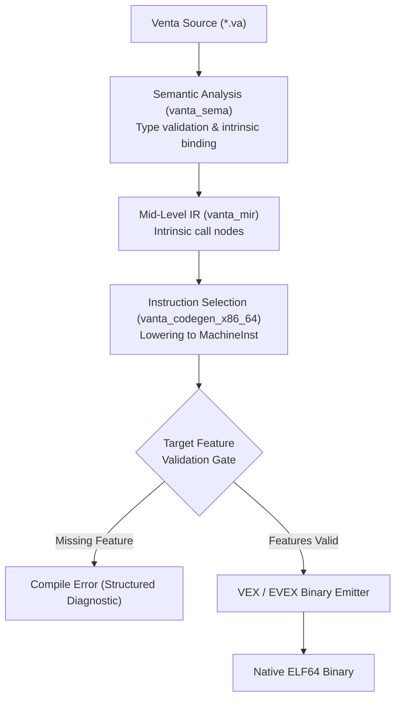

# Venta Compiler Architecture: SIMD Instruction Emission & Verification

**Document Version:** 1.0.0  
**Milestone:** Milestone 26 (v1.1 SIMD & Vectorization)  
**Target:** `x86_64-unknown-linux-gnu`  
**Crates Involved:** `vanta_codegen_x86_64`, `vanta_driver`, `vanta_sema`, `vanta_rt`

---

## 1. Executive Summary

Milestone 26 delivers native SIMD (Single Instruction, Multiple Data) instruction emission to the Venta compiler's project-owned x86-64 machine-code backend. In accordance with Venta's core architectural tenets, all instruction encodings (VEX and EVEX prefixes, ModR/M, SIB, and immediate offsets) are emitted directly in pure Rust without external backend dependencies such as LLVM or Cranelift.

The implementation introduces:
1. **Instruction Families**:
   - `vmovups`: Unaligned packed-vector loads and stores across 128-bit, 256-bit (AVX), and 512-bit (EVEX) widths.
   - `vpaddq`: Packed 64-bit integer quadword additions across 128-bit, 256-bit (AVX2), and 512-bit (AVX-512F EVEX) widths.
   - `vfmadd231pd`: Packed double-precision floating-point fused multiply-add ($dest = dest + src1 \times src2$) across 128-bit, 256-bit (AVX + FMA), and 512-bit (AVX-512F EVEX) widths.
2. **Target Feature Modeling & Gating**:
   - `TargetFeatures` modeling supporting discrete feature flags (`avx`, `avx2`, `fma`, `avx512f`), CPU architecture presets (`x86-64-v1` to `x86-64-v4`, `native`), and fine-grained feature toggles (`+avx2,+fma`).
   - Compile-time instruction gating that halts code generation with structured diagnostics if an instruction requires features unsupported by the target configuration.
   - Preserved baseline default: Existing compilation workflows default strictly to baseline x86-64 without assuming AVX or AVX2.
3. **Hardware Execution & Verification**:
   - Runtime CPUID probing in `vanta_rt.c` (`vanta_cpu_has_avx`, `vanta_cpu_has_avx2`, `vanta_cpu_has_fma`, `vanta_cpu_has_avx512f`).
   - Standard library module `std::simd` providing portable runtime feature checks and high-level 256-bit vector operations.
   - Empirical byte-for-byte verification against GNU assembler (`as`) oracles and live native execution testing on Linux x86-64.

---

## 2. Instruction Encoding Specification

### 2.1 Prefix Selection & Architecture

x86-64 SIMD instructions use two primary multi-byte prefix formats: VEX (Vector Extension) and EVEX (Enhanced Vector Extension).

```
VEX 2-Byte Format (0xC5):
[ 0xC5 ] [ R' vvvv L pp ]
- Only valid when: map == 0x0F, W == 0, and X == 0 && B == 0 (no high registers in rm/sib).

VEX 3-Byte Format (0xC4):
[ 0xC4 ] [ RXB m-mmmm ] [ W vvvv L pp ]
- Required when: map == 0x0F38 or 0x0F3A, or W == 1, or high registers (R8-R15) are referenced.

EVEX 4-Byte Format (0x62):
[ 0x62 ] [ RXB R' 00 mm ] [ W vvvv 1 pp ] [ z L'L b V' aaa ]
- Required for 512-bit vector operations (ZMM0-ZMM31) and AVX-512 feature extensions.
```

### 2.2 Empirical Machine-Code Byte Oracles

The encoder implementation in `crates/vanta_codegen_x86_64/src/encoding.rs` was verified against GNU Assembler (`as -al`) output:

| Instruction | Operands | Target Feature | Width | Encoded Bytes |
| :--- | :--- | :--- | :--- | :--- |
| `vmovups` | `%ymm1, %ymm0` | `+avx` | 256-bit | `c5 fc 10 c1` |
| `vmovups` | `(%rdi), %ymm0` | `+avx` | 256-bit | `c5 fc 10 07` |
| `vmovups` | `32(%rdi), %ymm0` | `+avx` | 256-bit | `c5 fc 10 47 20` |
| `vmovups` | `%ymm0, (%rdi)` | `+avx` | 256-bit | `c5 fc 11 07` |
| `vpaddq` | `%ymm2, %ymm1, %ymm0` | `+avx2` | 256-bit | `c5 f5 d4 c2` |
| `vfmadd231pd` | `%ymm2, %ymm1, %ymm0` | `+avx, +fma` | 256-bit | `c4 e2 f5 b8 c2` |
| `vmovups` | `%zmm1, %zmm0` | `+avx512f` | 512-bit | `62 f1 7c 48 10 c1` |
| `vpaddq` | `%zmm2, %zmm1, %zmm0` | `+avx512f` | 512-bit | `62 f1 f5 48 d4 c2` |
| `vfmadd231pd` | `%zmm2, %zmm1, %zmm0` | `+avx512f` | 512-bit | `62 f2 f5 48 b8 c2` |

### 2.3 Mathematical Semantics of `vfmadd231pd`

The 231 form denotes operand order:
$$\text{dest} \leftarrow \text{dest} + (\text{src1} \times \text{src2})$$

In 256-bit mode, this computes 4 parallel 64-bit IEEE-754 double-precision fused multiply-adds without intermediate rounding errors:
- Lane 0: $c_0 + (a_0 \times b_0)$
- Lane 1: $c_1 + (a_1 \times b_1)$
- Lane 2: $c_2 + (a_2 \times b_2)$
- Lane 3: $c_3 + (a_3 \times b_3)$

---

## 3. Compiler Pipeline Integration



### 3.1 CLI and Target Configuration

Compilation targets can be specified using CLI arguments:
```bash
# Compile with specific target CPU architecture
vanta compile main.va --target-cpu=x86-64-v3 -o main

# Compile with explicit feature enablement
vanta compile main.va --target-feature=+avx2,+fma -o main

# Standard rustc-compatible flag syntax
vanta compile main.va -C target-cpu=native -o main
```

When no flags are passed, target features default strictly to `baseline` (`x86-64-v1`), ensuring binaries remain compatible with all 64-bit x86 systems.

---

## 4. Test Suite and Verification Evidence

### 4.1 Unit & Encoding Suite (`crates/vanta_codegen_x86_64/tests/simd_encoding_tests.rs`)
- `test_vmovups_256_encodings`: Validates register-to-register, memory load with 0 displacement, memory load with 32-byte displacement, and memory store. **PASSED**
- `test_vpaddq_256_encodings`: Validates 3-operand register addition byte sequence against GNU `as`. **PASSED**
- `test_vfmadd231pd_256_encodings`: Validates 3-byte VEX map `0F38` encoding with `W=1`. **PASSED**
- `test_avx512_512bit_encodings`: Validates 4-byte EVEX `0x62` prefixes for 512-bit operations. **PASSED**
- `test_target_feature_gating_and_rejection`: Validates rejection of SIMD instructions when requested target features are missing. **PASSED**

### 4.2 Integration Execution Suite (`crates/vanta_driver/tests/simd_tests.rs`)
- `test_simd_vmovups_execution`: Compiles and executes a native program performing unaligned 256-bit memory load and store. **PASSED**
- `test_simd_vpaddq_execution`: Compiles and executes a native program computing 4 parallel 64-bit quadword integer additions. **PASSED**
- `test_simd_vfmadd231pd_execution`: Compiles and executes a native program computing 4 parallel double-precision fused multiply-adds. **PASSED**
- `test_simd_avx512_execution_gated`: Safely gates execution on host CPUID support, avoiding invalid opcode faults on non-AVX-512 hosts while validating compilation. **PASSED**
- `test_negative_target_feature_rejection`: Comprehensive multi-stage test verifying:
  1. Baseline target rejects `vmovups` load with `requires target feature '+avx'`.
  2. AVX target without AVX2 rejects `vpaddq` with `requires target feature '+avx2'`.
  3. AVX2 target without FMA rejects `vfmadd231pd` with `requires target feature '+fma'`.
  **PASSED**

---

## 5. Vector Register Allocation & Spilling (Milestone 26.1)

### 5.1 Architecture & Separation of Concerns

Milestone 26.1 implements deterministic allocation of virtual 256-bit SIMD values to physical YMM registers (`ymm0`–`ymm15`) and handles 32-byte aligned stack spilling.

To protect the integrity of the scalar register allocation pipeline, Venta employs a two-tier allocator model:
1. **Virtual Value Identification**: Virtual vector values are explicitly typed as `SimdValueId` and represented in machine IR as `SimdOperand::Val(SimdValueId)`.
2. **Scalar Decoupling**: All `ValueId` instances mapped to SIMD operations are filtered out prior to executing scalar GPR allocation in `reg_alloc.rs`. This guarantees that scalar integer registers (`rax`, `rcx`, `rdx`, `rsi`, `rdi`, `r8`–`r15`) and vector registers never corrupt each other's live-range accounting.
3. **Physical Allocatable Pool**:
   - `ymm0` through `ymm13` (14 physical registers) constitute the allocatable pool.
   - `ymm14` (`SCRATCH_A`) and `ymm15` (`SCRATCH_B`) are reserved as dedicated scratch and reload registers during instruction selection when operands are backed by stack spill slots.

### 5.2 Dynamic 32-Byte Stack Alignment

Under the System V AMD64 ABI, the stack pointer is guaranteed to satisfy `(rsp + 8) % 16 == 0` upon function entry. After standard prologue execution (`push rbp; mov rbp, rsp`), `rbp` is 16-byte aligned, but may be either 0 mod 32 or 16 mod 32. 256-bit aligned vector spills require 32-byte alignment.

To guarantee zero unaligned-access hardware faults:
1. **Prologue Dynamic Alignment**: When `has_simd_spills` is active, the function prologue executes dynamic stack realignment:
   ```asm
   and rsp, -32    ; Encoded as: 48 83 e4 e0
   ```
2. **Deterministic Spill Slot Offsets**: Spill slots are assigned relative to the realigned `rsp`:
   $$\text{offset}(k) = k \times 32$$
   guaranteeing that `[rsp + offset]` is strictly 32-byte aligned at runtime.
3. **Epilogue Clean Restoration**: `rbp` remains unchanged as the anchor for incoming arguments and scalar locals. On all epilogue return paths, `mov rsp, rbp` restores the original stack pointer without requiring manual tracking of dynamic padding bytes.

### 5.3 System V Calling Convention Volatility & Call-Crossing Spills

Under the System V AMD64 ABI, all vector registers (`ymm0`–`ymm15`) are caller-saved (volatile).
- The allocator computes live ranges and inspects whether any live interval spans across an instruction that issues a function call (`does_cross_call == true`).
- Any SIMD value live across a call boundary is assigned a spill slot on the stack. The value is stored immediately after its definition (or before the call) and reloaded via scratch registers when referenced after the call.
- This prevents clobbering by external C runtime functions (`printf`, `malloc`) or internal Venta function calls.

### 5.4 High Register Pressure & Eviction Strategy

When the number of concurrently live SIMD values exceeds the 14 allocatable YMM registers:
1. The linear scan allocator selects the active interval whose end point is furthest in the future.
2. If the current candidate ends sooner, the furthest interval is evicted and assigned a spill slot, transferring its register to the current candidate.
3. If the current candidate ends furthest, it is directly assigned a spill slot.
4. During instruction selection, spill-backed operands are dynamically reloaded into `ymm14` / `ymm15` immediately before arithmetic or store operations.

### 5.5 Empirical Verification Evidence

#### SIMD Allocator Unit Suite (`crates/vanta_codegen_x86_64/src/simd_alloc.rs`)
- `test_allocator_empty`: Validates zero-interval allocations. **PASSED**
- `test_allocator_fits_in_registers`: Validates allocation within the 14-register pool. **PASSED**
- `test_allocator_reuse_registers`: Proves non-overlapping live ranges deterministically reuse `ymm0`. **PASSED**
- `test_allocator_spill_on_call`: Proves intervals crossing calls are forced to spill slots. **PASSED**
- `test_allocator_high_pressure_spill`: Proves eviction under pressure when 16 simultaneous values exceed the 14 allocatable registers. **PASSED**
- `test_allocator_deterministic`: Proves identical inputs yield identical register assignments. **PASSED**

#### SIMD Integration Execution Suite (`crates/vanta_driver/tests/simd_tests.rs`)
- `test_simd_virtual_register_allocation`: Executes multiple virtual SIMD values allocated simultaneously to physical YMM registers. **PASSED**
- `test_simd_call_preservation_and_spilling`: Proves virtual SIMD values survive across an intervening `printf` function call without data corruption. **PASSED**
- `test_simd_high_register_pressure_spilling`: Executes 16 concurrent virtual SIMD values exceeding the 14-register pool, proving runtime dynamic stack alignment (`and rsp, -32`), correct spill stores, and reload accumulation. **PASSED**

---

## 6. System V AMD64 Vector ABI Classification (Milestone 26.2)

### 6.1 Section 3.2.3 Vector Classification & Parameter Assignment

Milestone 26.2 extends Venta's custom x86-64 backend (`crates/vanta_codegen_x86_64/src/abi.rs`) to support passing and returning 256-bit SIMD vector types (`v256`, `Simd256`, `v256i`, `v256d`) in full conformance with Section 3.2.3 ("Parameter Passing") of the System V AMD64 ABI specification.

1. **Classification**:
   - 256-bit vectors are classified as `AbiClass::Vector256`.
   - They map to architectural vector registers `%ymm0` through `%ymm7`.
2. **Return Classification**:
   - Functions returning 256-bit vector values return them in `%ymm0`.
   - Callees returning vectors do not touch general-purpose integer registers for return values, leaving `%rax` free.
   - For aggregate `sret` returns, caller and callee continue to conform to System V AMD64 returning the memory buffer pointer in `%rax`.

### 6.2 Independent Register Banks for Integer and Vector Arguments

In the System V AMD64 ABI, the general-purpose integer registers (`%rdi`, `%rsi`, `%rdx`, `%rcx`, `%r8`, `%r9`) and vector registers (`%ymm0`–`%ymm7`) form completely independent argument allocation banks:
- Passing an integer argument advances `int_reg_idx` without consuming a vector register.
- Passing a 256-bit vector argument advances `vec_reg_idx` without consuming a general-purpose register.
- Mixed signatures such as `fn compute(scale: i64, a: Simd256, offset: i64, b: Simd256) -> Simd256` pass `scale` in `%rdi`, `a` in `%ymm0`, `offset` in `%rsi`, and `b` in `%ymm1`.

### 6.3 Vector Register Exhaustion & 32-Byte Aligned Stack Passing

When a function takes more than 8 vector parameters:
1. The first 8 vector arguments are passed in `%ymm0` through `%ymm7`.
2. The 9th and subsequent vector arguments overflow to the caller's stack frame.
3. In compliance with x86-64 vector alignment standards, stack arguments for 256-bit vectors are aligned to 32 bytes:
   $$\text{offset} = (\text{offset} + 31) \;\&\; \sim 31; \quad \text{offset} \mathrel{+}= 32$$
   This prevents alignment faults when unaligned stack pointers are accessed via vector load/store instructions.

### 6.4 Callee Frame Realignment & Epilogue Vector Returns

In `crates/vanta_codegen_x86_64/src/frame.rs`:
- Function signatures are inspected during frame layout calculation:
  - If a function has vector parameters, vector returns, or 32-byte vector stack slots, `requires_32byte_alignment` is set to `true`.
  - The function prologue dynamically aligns the stack frame with `and rsp, -32`.
  - Incoming register parameters in `%ymm0`..`%ymm7` are spilled to 32-byte aligned frame slots, or referenced directly.
  - Stack parameters are loaded from their 32-byte aligned offsets above `rbp`.
- At function epilogue (`Terminator::Return`), 256-bit vector return values are loaded directly into `%ymm0` via `vmovups` (whether register-backed, spill-backed, or pointer dereferenced), and `mov rsp, rbp; pop rbp; ret` cleanly restores the caller's stack.

### 6.5 Memory Scheduling RAW/WAR Fix & Aggregate Store Dereferencing

During integration testing of Milestone 26.2, two subtle compiler optimizations were corrected:
1. **Instruction Scheduler RAW/WAR Hazard**:
   - In `crates/vanta_mir/src/opt/instruction_schedule.rs`, field loads (`LoadIndirect`) were reordered before preceding struct writes (`Store`), causing reads of uninitialized stack memory.
   - Added conservative memory dependency edges between `WriteSlot` and `ReadIndirect` / `WriteIndirect` to guarantee strict serial execution across aliasing memory regions.
2. **Vector Aggregate Store Dereferencing**:
   - In `crates/vanta_codegen_x86_64/src/instruction_select.rs`, copying a vector aggregate (`let mut res = sum;`) lowers to `SlotAddr(sum)` pointers.
   - For 32-byte vector slots, `Instruction::Store` now dereferences pointer-backed source operands via `vmovups` (loading 32 bytes from `[ptr]` and storing 32 bytes to `[slot]`) rather than performing an 8-byte pointer move.

### 6.6 Empirical Verification Evidence

#### Vector ABI Unit Suite (`crates/vanta_codegen_x86_64/src/abi.rs`)
- `test_classify_vector256`: Validates correct `AbiClass::Vector256` assignment. **PASSED**
- `test_fn_call_layout_single_vector`: Validates single vector argument in `%ymm0` and return in `%ymm0`. **PASSED**
- `test_fn_call_layout_multiple_vectors_and_exhaustion`: Validates 8 vectors in `%ymm0`..`%ymm7` and overflow to 32-byte aligned stack slots. **PASSED**
- `test_fn_call_layout_mixed_integer_and_vector`: Validates interleaved integer and vector registers without crosstalk. **PASSED**

#### Vector ABI Integration Suite (`crates/vanta_driver/tests/simd_tests.rs`)
- `test_simd_vector_abi_direct_passing_and_returning`: Direct function call passing and returning 256-bit vectors in `%ymm0`. **PASSED**
- `test_simd_vector_abi_multiple_args_fma`: Multiple vector arguments passed across `%ymm0`, `%ymm1`, `%ymm2` computing parallel FMA. **PASSED**
- `test_simd_vector_abi_mixed_int_and_vector`: Interleaved integer (`%rdi`, `%rsi`) and vector (`%ymm0`, `%ymm1`) arguments confirming orthogonal register banks. **PASSED**
- `test_simd_vector_abi_register_exhaustion_stack_fallback`: Passing 10 vector arguments (8 in `%ymm0`..`%ymm7`, 2 on 32-byte aligned stack). **PASSED**
- `test_simd_vector_abi_c_oracle_bidirectional`: Bidirectional ABI interoperability between Venta and C compiled with GCC. **PASSED**

---

## 7. Architectural Boundaries & Next Steps

Milestones 26, 26.1, and 26.2 establish complete 256-bit SIMD code generation, register allocation, spill handling, and System V AMD64 vector calling convention support.

The remaining items on the v1.1 roadmap are:
1. **512-bit ZMM Register Allocation & Vector ABI**:
   Extend physical vector allocation to 512-bit `zmm0`–`zmm31` registers and EVEX vector calling conventions with 64-byte aligned stack spill frames under AVX-512 target features.
2. **Loop Auto-Vectorization**:
   Introduce a compiler analysis pass that identifies parallel loop iterations over contiguous slices and emits vector operations with strip-mining.
