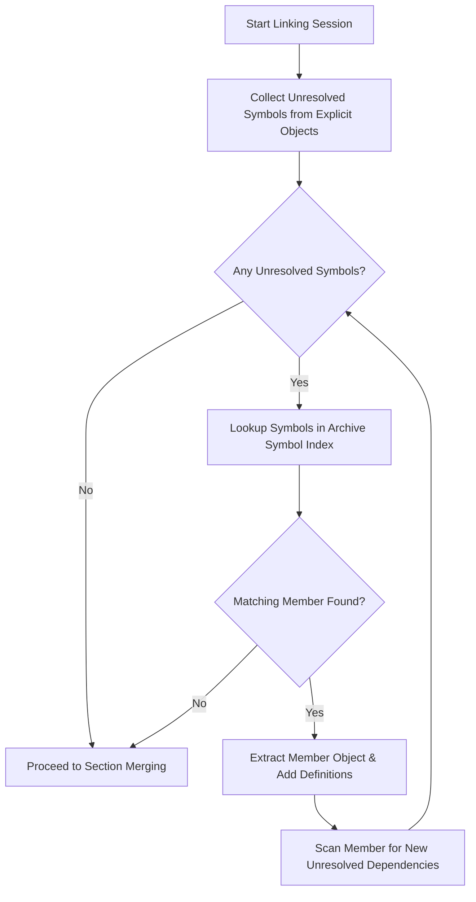

# Venta Static Archive Format & Symbol Index Specification

## 1. Overview

Venta v2.0 includes a self-contained archive management engine supporting standard Unix static libraries (`.a`) and Windows COFF libraries (`.lib`). It provides deterministic creation, validation, inspection, and symbol-driven lazy member extraction without invoking GNU `ar`, `llvm-ar`, or Microsoft `lib.exe`.

---

## 2. Archive Container Structure

All Venta archives adhere to the universal archive container format:
```
+-------------------------------------------------------------+
| Global Magic: "!<arch>\n" (8 bytes: 0x21 3C 61 72 63 68 3E 0A) |
+-------------------------------------------------------------+
| First Member: Symbol Index ("/" or "__.SYMDEF") (60B header) |
+-------------------------------------------------------------+
| Symbol Index Data (Big-endian or Little-endian symbol table) |
+-------------------------------------------------------------+
| Optional: Extended Filename Table ("//")                    |
+-------------------------------------------------------------+
| Member Object 1: 60-byte Header + Raw Object Bytes + Pad    |
+-------------------------------------------------------------+
| Member Object 2: 60-byte Header + Raw Object Bytes + Pad    |
+-------------------------------------------------------------+
```

### 2.1 Fixed 60-Byte Member Header

Every member is preceded by an ASCII header formatted exactly as:
```
Offset  Size  Field Description
0       16    File identifier / name (e.g. "math.o/", "/0", or "#1/24")
16      12    File modification timestamp (ASCII decimal, e.g. "0           ")
28      6     Owner user ID (ASCII decimal, e.g. "0     ")
34      6     Group ID (ASCII decimal, e.g. "0     ")
40      8     File mode in octal (ASCII, e.g. "100644  ")
48      10    Member payload size in bytes (ASCII decimal, e.g. "14520     ")
58      2     Header trailer magic: 0x60 0x0A ("`\n")
```
Every member payload is padded with a newline character (`0x0A`) if its length is odd, ensuring 2-byte alignment.

---

## 3. Symbol Index Formats

Venta's parser supports all three major symbol index standards:

### 3.1 GNU 32-bit Symbol Table (`/`)
- Stored as the first member named `/`.
- First 4 bytes: 32-bit big-endian unsigned integer indicating the number of symbol entries ($N$).
- Next $N \times 4$ bytes: Array of 32-bit big-endian file offsets to each member header defining that symbol.
- Trailing bytes: NUL-terminated (`\0`) ASCII string table of symbol names matching the offset array.

### 3.2 GNU 64-bit Symbol Table (`/SYM64/`)
- Emitted by modern GNU `ar` for 64-bit or large static archives.
- First member named `/SYM64/`.
- First 8 bytes: 64-bit big-endian unsigned integer indicating symbol count ($N$).
- Next $N \times 8$ bytes: Array of 64-bit big-endian file offsets to each defining member.
- Trailing bytes: NUL-terminated string table.

### 3.3 COFF First Linker Member (`/`)
- Common on Windows static libraries (`.lib`).
- Similar layout to the GNU table, containing 32-bit symbol counts and member offsets.

### 3.4 BSD / Darwin `__.SYMDEF` and `__.SYMDEF SORTED`
- Used in traditional BSD and macOS Apple archives.
- Begins with a table of `ranlib` structures: `ran_strx` (string table offset) and `ran_off` (member file offset).
- Followed by an 8-byte length prefix and string pool.

---

## 4. Lazy Member Extraction Algorithm

Rather than extracting all members or scanning raw object files sequentially, Venta's linker performs lazy, dependency-driven extraction:



1. **Root Set**: Collect all unresolved symbols across command-line specified object files.
2. **Index Lookup**: Check if any unresolved symbol exists in the archive's symbol index.
3. **Selective Extraction**: Extract only the specific member object defining the symbol.
4. **Transitive Expansion**: Scan the newly extracted member for its own unresolved external dependencies (e.g. function `A` in `a.o` calls helper `B` in `b.o`).
5. **Fixed Point**: Repeat steps 2–4 until all symbols are resolved or no archive defines any remaining unresolved symbol.
6. **Dead Stripping of Members**: Any archive member whose symbols were never requested is omitted from the final binary, guaranteeing minimal binary size.

---

## 5. CLI Toolchain Interface

Venta provides built-in commands under `ventac archive`:

### 5.1 Create an Archive
```bash
ventac archive create libcore.a math.o memory.o string.o
```
Creates a deterministic, reproducible archive containing `math.o`, `memory.o`, and `string.o` with an indexed `/` symbol table.

### 5.2 List Archive Members
```bash
ventac archive list libcore.a
```
Outputs:
```
math.o
memory.o
string.o
```

### 5.3 Deep Inspection
```bash
ventac archive inspect libcore.a
```
Outputs:
```
Archive: libcore.a
Total size: 45280 bytes
Members (3):
  - math.o                         (12400 bytes)
  - memory.o                       (18200 bytes)
  - string.o                       (14520 bytes)
Symbols (12):
  - math_add                       -> math.o
  - math_mul                       -> math.o
  - vanta_alloc                    -> memory.o
  - vanta_free                     -> memory.o
  - vanta_str_concat               -> string.o
```
