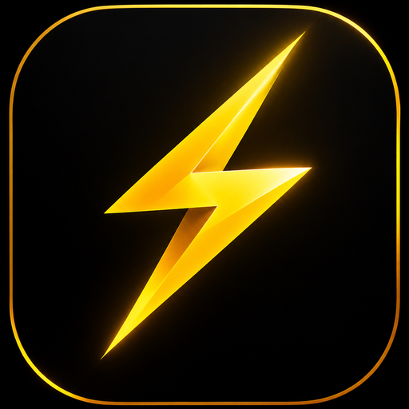

<p align="center">
  
</p>

<h1 align="center">Vanta Language Support & File Icons</h1>

<p align="center">
  Official Visual Studio Code extension providing language grammar, syntax highlighting, and <strong>custom 3D gold lightning file icons</strong> for the <strong>Vanta Systems Programming Language</strong> (<code>.va</code>, <code>.vanta</code>).
</p>

---

## ⚡ Features

- **⚡ Official Vanta File Icons:** Automatically attaches the glowing 3D gold faceted lightning mark to `.va` and `.vanta` files in the explorer tree, tabs, breadcrumbs, and Go-to-File picker.
- **🎨 Dark & Light Theme Adaptive:** Dedicated radiant gold icon for dark themes (`vanta-file-icon-dark.svg`) and high-contrast amber-bronze icon for light themes (`vanta-file-icon-light.svg`).
- **🗂️ Built-in Icon Theme:** Includes the "Vanta File Icons" theme (`vanta-icons`) for full explorer file icon integration.
- **✨ Complete Syntax Highlighting:** Grammar coverage for all Vanta language keywords (`fn`, `let`, `mut`, `struct`, `impl`, `trait`, `match`, etc.), primitive and custom types, string escapes, memory operators, and numbers.
- **🔒 Bracket Matching & Auto-closing:** Automatic closing pairs for `{}`, `[]`, `()`, and `""`.
- **💬 Comment Toggling:** Standard line (`//`) and multi-line block (`/* */`) comments.

---

## 📁 File Icon Preview

```text
📁 src/
├── ⚡ main.va        <-- Official Vanta Gold Lightning Icon
├── ⚡ router.va
├── ⚡ server.va
└── ⚡ mod.va
```

---

## 🚀 Local Installation

To use this extension immediately in your local Antigravity IDE or VS Code installation:

### Antigravity IDE (Windows PowerShell):
```powershell
New-Item -ItemType Junction -Path "$HOME\.antigravity-ide\extensions\venta-vscode" -Target "$PWD\editors\vscode"
```

### Visual Studio Code (Windows PowerShell):
```powershell
New-Item -ItemType Junction -Path "$HOME\.vscode\extensions\venta-vscode" -Target "$PWD\editors\vscode"
```

### Linux / macOS:
```bash
ln -s "$(pwd)/editors/vscode" ~/.vscode/extensions/venta-vscode
# Or for Antigravity IDE:
ln -s "$(pwd)/editors/vscode" ~/.antigravity-ide/extensions/venta-vscode
```

Restart the IDE or reload the window (`Ctrl+Shift+P` -> `Developer: Reload Window`). All `.va` and `.vanta` files will immediately display the official gold lightning icon and full syntax highlighting!
